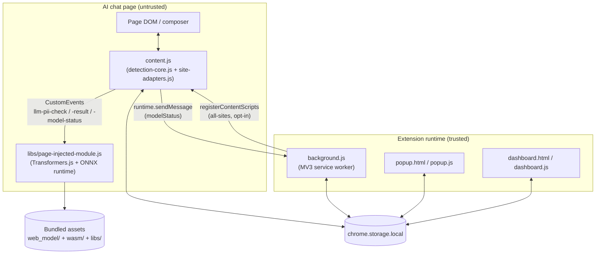
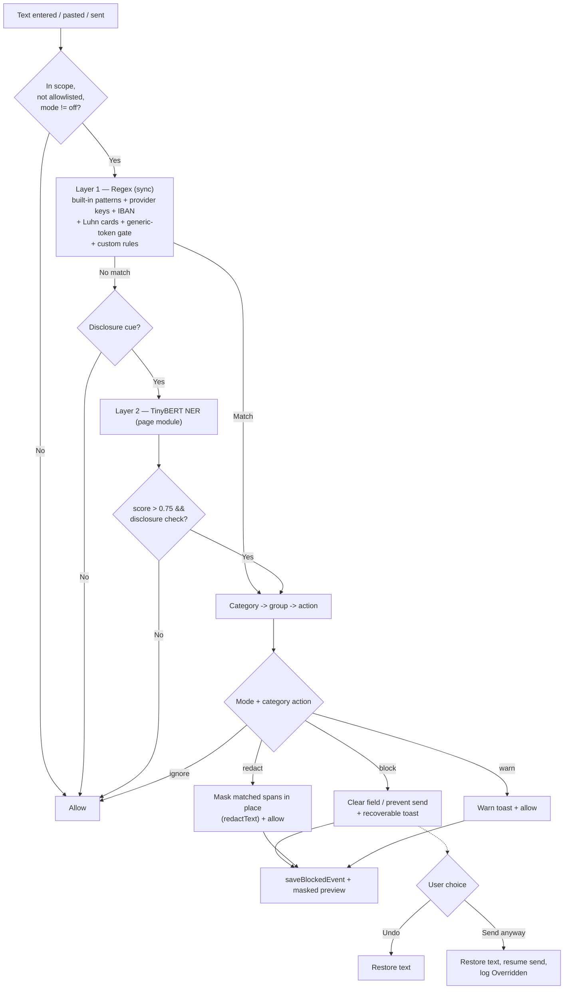
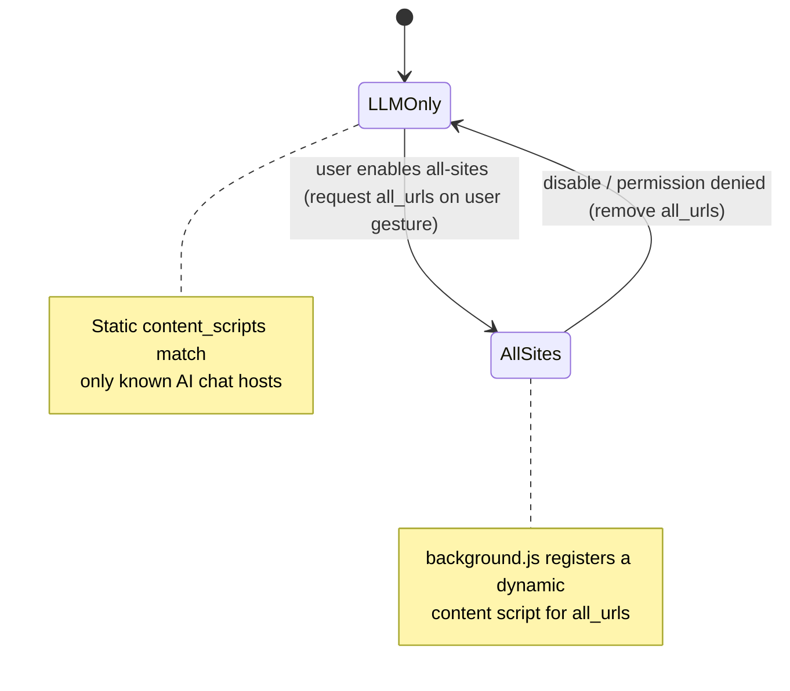

# Architecture — LLM Data Leakage Monitor

A maintainable, text-based companion to the architecture diagram
(`LLM Data Leakage Monitor Architecture.png`). It reflects the current system,
including custom rules, redaction, Luhn card validation, block recovery
(Undo / Send anyway), masked match previews, and settings backup/restore.

See also: `HLD.md` (high-level design) and `LLD.md` (module internals).

---

## 1. Runtime contexts and trust boundary

The extension spans four execution contexts. The **page/DOM context is
untrusted**; the extension runtime (service worker, popup, dashboard) is trusted.



Key points:
- `detection-core.js` and `site-adapters.js` are UMD modules loaded both as
  content scripts (page) and by `background.js` / Node tests.
- All NER inference runs in the **page** context (`page-injected-module.js`),
  not the service worker, because MV3 workers cannot spawn the `blob:` Web
  Workers that ONNX Runtime's threaded WASM backend needs.
- No prompt text leaves the browser; the model is bundled and loaded locally.

---

## 2. Component responsibilities

| Layer | File(s) | Responsibility |
|---|---|---|
| Interception & orchestration | `content.js` | Listen to input/paste/drop, intercept send (keydown/click/submit), run detection, apply verdicts (block / redact / warn), show recoverable toasts, record events |
| Detection engine | `detection-core.js` | Built-in regex (incl. provider keys + IBAN), Luhn card validation, generic-token gate, custom-rule compilation, span-based redaction, masked previews, NER decisioning, policy mapping, settings normalization |
| Site adapters | `site-adapters.js` | ChatGPT/Claude composer + send-button selectors, LLM host list, send-key detection |
| NER inference | `libs/page-injected-module.js` | Load TinyBERT NER (ONNX, quantized), answer `llm-pii-check`, emit model status |
| Service worker | `background.js` | Seed defaults, relay model status, register/unregister the opt-in all-sites script |
| UI | `popup.*`, `dashboard.*` | Mode/scope controls, analytics, event log (with masked match), policy + custom-rule + allowlist settings, CSV export, settings JSON backup/restore |
| Config | `manifest.json` | Scoped host matches, permissions, content-script + web-accessible-resource registration |

---

## 3. Detection pipeline (data flow)



- **Two stages, cheapest first.** Synchronous regex runs on every candidate;
  NER is invoked only when regex is clean *and* a disclosure cue is present,
  keeping inference off the keystroke path.
- **Custom rules** join the regex layer and carry their own `custom` policy.
- **Luhn** gates payment-card matches to reduce false positives.
- **Redact mode** masks only the matched spans and lets the rest through.
- **Block recovery** keeps the cleared text in memory for Undo / Send anyway.

---

## 4. NER request/response (page ↔ content script)

```mermaid
sequenceDiagram
    participant CS as content.js
    participant PM as page-injected-module.js
    participant RT as ONNX runtime + model
    CS->>PM: CustomEvent llm-pii-check { id, text }
    PM->>RT: token-classification(text)
    RT-->>PM: entities [{ entity_group, score, start, end }]
    PM-->>CS: CustomEvent llm-pii-result { id, entities }
    Note over CS: correlate by id;\n2500ms timeout -> resolve [] (fail-open)
    PM-->>CS: CustomEvent llm-model-status { status }
    CS->>CS: relay status to service worker
```

---

## 5. Scope and least-privilege permissions



- The static content script covers only known LLM hosts.
- `<all_urls>` is an **optional** permission requested at runtime from a user
  gesture; declining keeps the extension on LLM-only.
- `background.js#syncAllSitesScript` keeps the dynamic script in lockstep with
  the scope setting and whether the permission is actually granted.

---

## 6. Storage and settings

All state is local (`chrome.storage.local`); nothing is sent remotely.

| Key | Purpose |
|---|---|
| `llmLeakageSettings` | `{ mode, scope, allowlist[], categoryActions, customRules[] }` |
| `llmBlockedEvents` | up to 200 metadata records incl. a **masked** match preview |
| `llmModelStatus` | `loading` / `ready` / `error` |

- **Modes:** `block`, `redact`, `warn`, `off`.
- **Category groups:** `secrets`, `secrets2` (provider keys), `identity`,
  `tokens`, `contact`, `personal`, `ner`, `custom`.
- **Defaults:** `secrets`, `secrets2`, `identity`, `custom` → block; rest → warn.
- **Event previews** are non-reversible (head/tail kept, middle starred); the
  raw value and the full prompt text are never stored.
- **Backup/restore** exports/imports settings (not events) as JSON, always
  re-validated through `mergeSettings` on import.

---

## 7. Quality attributes

| Attribute | How it is achieved |
|---|---|
| Privacy | On-device inference; metadata-only storage with masked previews; no remote model fetch during detection; export excludes events |
| Performance | Debounced input; synchronous regex first; NER gated by disclosure cue; page-module result caching |
| False-positive handling | Luhn card validation; entropy/keyword token gate; redact mode; Undo / Send anyway recovery |
| Least privilege | Scoped host matches; opt-in `<all_urls>`; permission re-checked on import |
| Resilience | Adapter selectors ordered specific→generic; NER send-hold timeout fails open; try/catch around inference and rule compilation |
| Testability | UMD detection/adapter modules; unit + dataset suites; ESLint + CI |

---

## 8. Regenerating the diagram image

`LLM Data Leakage Monitor Architecture.png` is the rendered diagram shown in the
README. When the architecture changes, update the Mermaid sources in this file
and re-export the PNG (for example by pasting the Section 1 diagram into a
Mermaid renderer such as the Mermaid Live Editor and exporting at the same
dimensions). Keep this document as the source of truth; the PNG is a snapshot.
