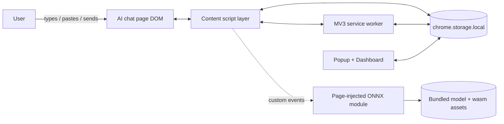
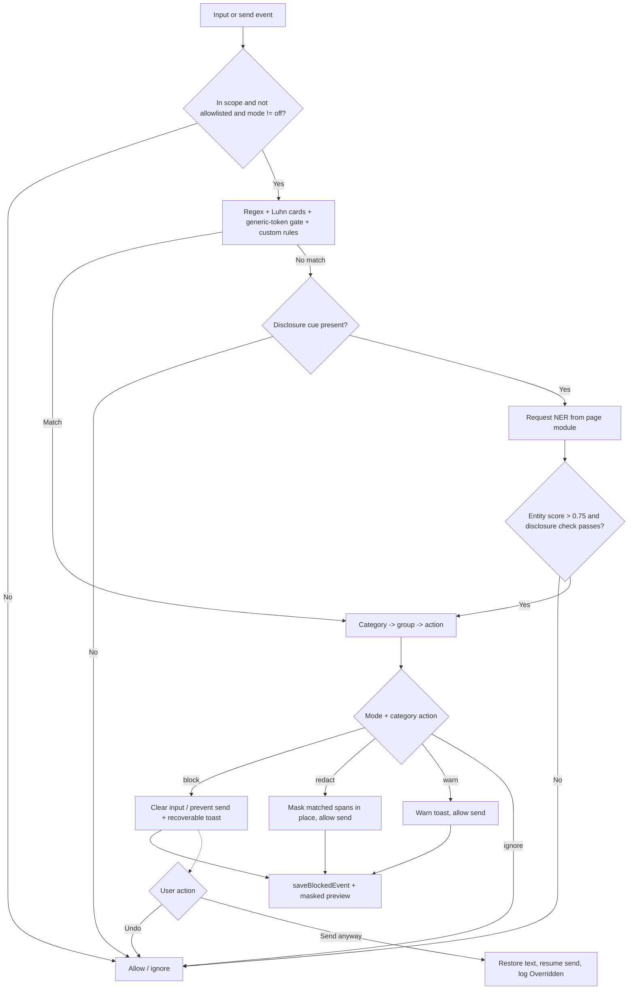

# High-Level Design (HLD) — LLM Data Leakage Monitor

## 1. Purpose

The LLM Data Leakage Monitor is a local-first Chrome extension (Manifest V3) that
inspects text a user types, pastes, or sends into AI chat sites and flags or
blocks accidental disclosure of secrets and sensitive personal information
before it is submitted. All detection runs in the browser; no prompt text is
sent to any remote service.

## 2. Goals and non-goals

### Goals
- Catch common secrets (API keys, provider tokens, private keys, connection
  strings) and personal data (email, phone, SSN, Luhn-validated payment cards,
  IBANs, names, addresses) before send.
- Run entirely on-device: regex plus a bundled TinyBERT NER ONNX model.
- Let users extend detection with their own regex/keyword rules for internal
  secret formats and project-specific identifiers.
- Give the user control: Block / Redact / Warn / Off modes, per-category
  policies, a trusted-domain allowlist, and a scope switch (LLM sites only vs.
  all sites).
- Make a blocked prompt recoverable: offer Undo and Send-anyway so a reviewed
  false positive is not lost.
- Record local, metadata-only history (including a masked, non-reversible
  preview of the match) and present analytics in a dashboard.
- Let users back up and share their configuration via JSON export/import.
- Default to least privilege: only request access to known AI chat hosts; make
  broad "all sites" access an explicit opt-in.

### Non-goals
- Not a guaranteed DLP solution. Detection is best-effort and can miss values.
- Does not store or transmit the actual prompt text anywhere.
- Does not train or fine-tune the model; the pretrained model is used as-is.
- Does not validate whether a matched credential is real or active.

## 3. System context

- **Actors:** the end user, the AI chat web page, and Chrome's extension runtime.
- **Trust boundary:** the page/DOM context is untrusted; the extension runtime
  (service worker, popup, dashboard) is trusted. Detection logic is shared and
  runs in both the page content-script context and Node tests.

## 4. Component overview

| Component | Context | Responsibility |
|---|---|---|
| `content.js` | Page (content script) | Attach input/paste/drop listeners, intercept send events, orchestrate detection, apply verdicts (block / redact / warn), show recoverable toasts (Undo / Send anyway), record events |
| `detection-core.js` | Shared (page + Node) | Regex rules (incl. provider keys, IBAN), Luhn card validation, generic-token gate, custom-rule compilation, span-based redaction, masked previews, NER decision logic, category→policy mapping, settings merge |
| `site-adapters.js` | Shared (page + Node) | ChatGPT/Claude composer + send-button selectors, LLM host list, send-key detection |
| `libs/page-injected-module.js` | Page (ES module) | Load and run the TinyBERT NER ONNX model via Transformers.js; answer NER requests |
| `background.js` | Service worker | Seed defaults, relay model status to badge, register/unregister the dynamic all-sites content script |
| `popup.js` / `popup.html` | Extension page | Quick mode (block/redact/warn/off) + scope controls, recent events, model status |
| `dashboard.js` / `dashboard.html` | Extension page | Analytics, event table with masked match preview, policy/allowlist/custom-rule settings, CSV export, settings JSON backup/restore |
| `manifest.json` | Config | Permissions, scoped host matches, content-script + web-accessible-resource registration |

## 5. Key design decisions

### 5.1 Two-stage detection (regex first, NER second)
Regex is synchronous and cheap, so it runs first on every candidate text. The
NER model is only invoked when regex finds nothing **and** the text contains a
disclosure cue (for example "my name is", "I live at"). This keeps latency low
and avoids running inference on every keystroke.

### 5.2 NER runs in the page context, not the service worker
MV3 service workers cannot spawn `blob:` Web Workers, which ONNX Runtime's
multi-threaded WASM backend requires. The model therefore runs in a script
injected into the page context (`page-injected-module.js`). The content script
communicates with it over `CustomEvent`s (`llm-pii-check` / `llm-pii-result`)
and relays model status to the service worker.

### 5.3 Least-privilege permission model
The static content script matches only a known list of AI chat hosts. The broad
`<all_urls>` origin is declared as an **optional** host permission. Switching to
"all sites" scope requests that permission at runtime (from a user gesture in
the popup or dashboard) and registers a dynamic content script; switching back
unregisters it and removes the permission.

### 5.4 Generic-token false-positive gate
Long opaque alphanumeric strings (32/40/64 chars) are common in coding chats
(git SHAs, UUIDs, checksums). Instead of matching them blindly, candidates are
vetted: a token is treated as a secret only when a secret keyword cue is nearby
(`api_key`, `token`, `secret`, ...) or the token is high-entropy mixed-case with
digits. Pure-hex checksums without a cue are ignored.

### 5.5 Local, metadata-only storage
All state lives in `chrome.storage.local`. Event records store only metadata
(action, category, detection method, domain, source, timestamp) plus a **masked,
non-reversible preview** of the matched value (for example `AKIA**********CDEF`)
— never the submitted text or the full secret. History is capped at 200 records.

### 5.6 Custom detection rules
Users can add their own rules (`regex` or `keyword`) from the dashboard. Rules
are validated at save time (uncompilable regex is rejected), capped at 50,
deduplicated, and stored in `settings.customRules`. They run alongside the
built-in patterns in `containsSensitiveRegex` / `matchingCategories` and are
governed by a dedicated `custom` category group (default: block). A user rule's
`name` becomes its category label, so it flows through the same policy and
reporting path as built-in categories.

### 5.7 Redaction mode
In `redact` mode a detected disclosure is not cleared or merely warned about:
the specific sensitive spans are replaced in place with labeled placeholders
(`[EMAIL]`, `[AWS_KEY]`, …) and the rest of the prompt is allowed through.
`sensitiveSpans()` collects labeled `[start,end)` ranges (built-in patterns,
Luhn-valid cards, vetted generic tokens, and custom rules); `redactText()`
merges overlaps and rewrites the string. Disclosure *cue phrases* (e.g. "my name
is") are marked `cueOnly` and excluded from masking, since the value they
introduce — not the phrase — is what matters; a cue-only hit with nothing
maskable falls back to a warning so the send is not silently allowed.

### 5.8 Recoverable blocks (Undo / Send anyway)
When block mode clears a field, the original text is held in memory and the
toast offers **Undo** (restore the text) and, when a send adapter is present,
**Send anyway** (restore and resume the send once, logged as an `Overridden`
event). This mitigates the cost of false positives without weakening the
default block behavior.

### 5.9 Luhn validation for payment cards
Card detection no longer trusts any 15/16-digit run. Candidate sequences
(13–19 digits, optionally grouped) are validated with the Luhn checksum, which
sharply cuts false positives on order numbers and long numeric IDs — mirroring
the entropy/keyword philosophy of the generic-token gate.

### 5.10 Settings backup and restore
The dashboard can export the configuration (mode, scope, category policies,
allowlist, custom rules — not event history) as a JSON file and import it back.
Imports are always run through `mergeSettings()`, so an untrusted or malformed
file cannot inject invalid state (bad rules dropped, mode/scope normalized); an
imported "all sites" scope still requires the runtime host-permission grant.

## 6. Primary data flow (detection on send)

## 7. Settings and policy model

- **Modes:** `block` (follow category action, clear the field), `redact` (mask
  matched spans in place and allow), `warn` (cap all blocks to warn), `off`
  (disable detection).
- **Category groups:** `secrets`, `secrets2` (provider keys), `identity`,
  `tokens`, `contact`, `personal`, `ner`, `custom`. Each group maps to an action
  (`block` / `warn` / `ignore`).
- **Default policy:** `secrets`, `secrets2`, `identity`, and `custom` → block;
  everything else → warn.
- **Custom rules:** `settings.customRules` is an array of
  `{ name, type: 'regex'|'keyword', pattern, flags? }`; validated and capped by
  `mergeSettings` / `normalizeCustomRules`.
- **Scope:** `llm` (default) or `all`.
- **Allowlist:** trusted domains that are never monitored.
- **Backup/restore:** the above (excluding event history) can be exported and
  imported as JSON through the dashboard.

## 8. Quality attributes

| Attribute | Approach |
|---|---|
| Privacy | On-device inference; metadata-only storage with non-reversible masked previews; no remote model fetch during detection; settings export excludes event history |
| False-positive handling | Luhn card validation; entropy/keyword generic-token gate; Undo / Send-anyway recovery on blocks; redact mode to salvage the clean part of a prompt |
| Performance | Debounced input handling; synchronous regex first; NER gated by disclosure cue; result caching in the page module |
| Security / least privilege | Scoped host permissions; opt-in broad access; HTML-escaped dashboard rendering |
| Resilience | Adapter selectors ordered specific→generic; NER send-hold has a timeout fail-open; try/catch around inference |
| Testability | Detection logic is a UMD module usable by Node tests; unit + dataset test suites; ESLint + CI |

## 9. Risks and limitations

- Regex covers only implemented formats; unfamiliar secrets can be missed.
- The generic-token gate can skip a real secret that has no keyword cue and is
  not high-entropy.
- NER can miss PII phrased without a supported disclosure cue.
- Site-adapter selectors can break when a chat site changes its UI.
- The NER send-hold fails open on timeout, so a slow machine effectively skips
  NER blocking for that send.

## 10. Deployment and testing

- **Install:** load unpacked in `chrome://extensions`; all assets are bundled.
- **Model refresh:** optional `download_model.py` pulls the ONNX model from
  Hugging Face into `web_model/bert-tiny-ner/`.
- **Tests/CI:** `npm run lint` (ESLint), `npm test` (unit checks),
  `npm run test:dataset` (200-case regex + NER run). Lint and unit tests run in
  GitHub Actions on push/PR.
