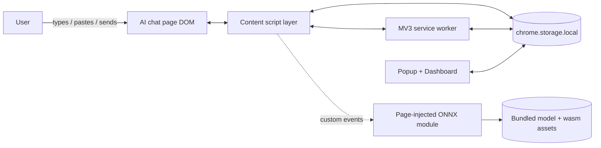
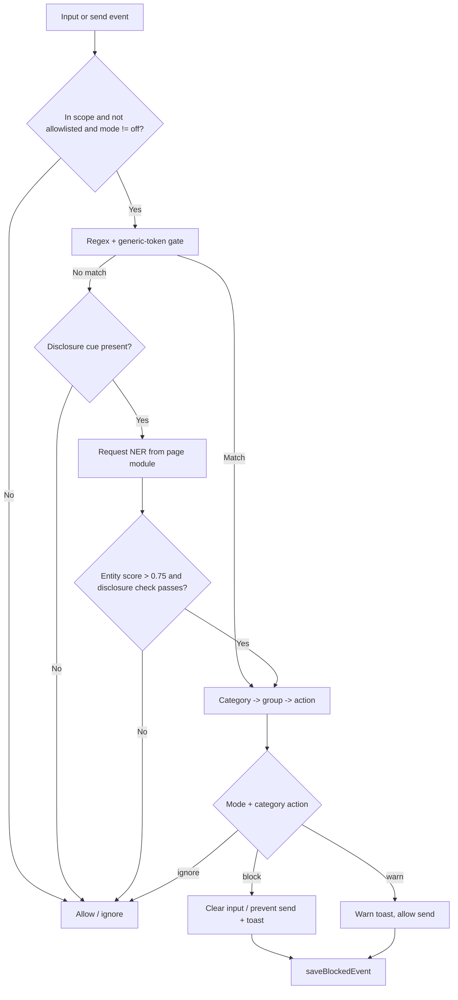

# High-Level Design (HLD) — LLM Data Leakage Monitor

## 1. Purpose

The LLM Data Leakage Monitor is a local-first Chrome extension (Manifest V3) that
inspects text a user types, pastes, or sends into AI chat sites and flags or
blocks accidental disclosure of secrets and sensitive personal information
before it is submitted. All detection runs in the browser; no prompt text is
sent to any remote service.

## 2. Goals and non-goals

### Goals
- Catch common secrets (API keys, tokens, private keys, connection strings) and
  personal data (email, phone, SSN, payment cards, names, addresses) before send.
- Run entirely on-device: regex plus a bundled TinyBERT NER ONNX model.
- Give the user control: Block / Warn / Off modes, per-category policies, a
  trusted-domain allowlist, and a scope switch (LLM sites only vs. all sites).
- Record local, metadata-only history and present analytics in a dashboard.
- Default to least privilege: only request access to known AI chat hosts; make
  broad "all sites" access an explicit opt-in.

### Non-goals
- Not a guaranteed DLP solution. Detection is best-effort and can miss values.
- Does not store or transmit the actual prompt text anywhere.
- Does not train or fine-tune the model; the pretrained model is used as-is.
- Does not validate whether a matched credential is real or active.

## 3. System context

- **Actors:** the end user, the AI chat web page, and Chrome's extension runtime.
- **Trust boundary:** the page/DOM context is untrusted; the extension runtime
  (service worker, popup, dashboard) is trusted. Detection logic is shared and
  runs in both the page content-script context and Node tests.

## 4. Component overview

| Component | Context | Responsibility |
|---|---|---|
| `content.js` | Page (content script) | Attach input/paste/drop listeners, intercept send events, orchestrate detection, apply verdicts, record events |
| `detection-core.js` | Shared (page + Node) | Regex rules, generic-token gate, NER decision logic, category→policy mapping, settings merge |
| `site-adapters.js` | Shared (page + Node) | ChatGPT/Claude composer + send-button selectors, LLM host list, send-key detection |
| `libs/page-injected-module.js` | Page (ES module) | Load and run the TinyBERT NER ONNX model via Transformers.js; answer NER requests |
| `background.js` | Service worker | Seed defaults, relay model status to badge, register/unregister the dynamic all-sites content script |
| `popup.js` / `popup.html` | Extension page | Quick mode + scope controls, recent events, model status |
| `dashboard.js` / `dashboard.html` | Extension page | Analytics, event table, policy/allowlist settings, CSV export |
| `manifest.json` | Config | Permissions, scoped host matches, content-script + web-accessible-resource registration |

## 5. Key design decisions

### 5.1 Two-stage detection (regex first, NER second)
Regex is synchronous and cheap, so it runs first on every candidate text. The
NER model is only invoked when regex finds nothing **and** the text contains a
disclosure cue (for example "my name is", "I live at"). This keeps latency low
and avoids running inference on every keystroke.

### 5.2 NER runs in the page context, not the service worker
MV3 service workers cannot spawn `blob:` Web Workers, which ONNX Runtime's
multi-threaded WASM backend requires. The model therefore runs in a script
injected into the page context (`page-injected-module.js`). The content script
communicates with it over `CustomEvent`s (`llm-pii-check` / `llm-pii-result`)
and relays model status to the service worker.

### 5.3 Least-privilege permission model
The static content script matches only a known list of AI chat hosts. The broad
`<all_urls>` origin is declared as an **optional** host permission. Switching to
"all sites" scope requests that permission at runtime (from a user gesture in
the popup or dashboard) and registers a dynamic content script; switching back
unregisters it and removes the permission.

### 5.4 Generic-token false-positive gate
Long opaque alphanumeric strings (32/40/64 chars) are common in coding chats
(git SHAs, UUIDs, checksums). Instead of matching them blindly, candidates are
vetted: a token is treated as a secret only when a secret keyword cue is nearby
(`api_key`, `token`, `secret`, ...) or the token is high-entropy mixed-case with
digits. Pure-hex checksums without a cue are ignored.

### 5.5 Local, metadata-only storage
All state lives in `chrome.storage.local`. Event records store only metadata
(action, category, detection method, domain, source, timestamp) — never the
submitted text. History is capped at 200 records.

## 6. Primary data flow (detection on send)

## 7. Settings and policy model

- **Modes:** `block` (follow category action), `warn` (cap all blocks to warn),
  `off` (disable detection).
- **Category groups:** `secrets`, `identity`, `tokens`, `contact`, `personal`,
  `ner`. Each group maps to an action (`block` / `warn` / `ignore`).
- **Default policy:** secrets and identity → block; everything else → warn.
- **Scope:** `llm` (default) or `all`.
- **Allowlist:** trusted domains that are never monitored.

## 8. Quality attributes

| Attribute | Approach |
|---|---|
| Privacy | On-device inference; metadata-only storage; no remote model fetch during detection |
| Performance | Debounced input handling; synchronous regex first; NER gated by disclosure cue; result caching in the page module |
| Security / least privilege | Scoped host permissions; opt-in broad access; HTML-escaped dashboard rendering |
| Resilience | Adapter selectors ordered specific→generic; NER send-hold has a timeout fail-open; try/catch around inference |
| Testability | Detection logic is a UMD module usable by Node tests; unit + dataset test suites; ESLint + CI |

## 9. Risks and limitations

- Regex covers only implemented formats; unfamiliar secrets can be missed.
- The generic-token gate can skip a real secret that has no keyword cue and is
  not high-entropy.
- NER can miss PII phrased without a supported disclosure cue.
- Site-adapter selectors can break when a chat site changes its UI.
- The NER send-hold fails open on timeout, so a slow machine effectively skips
  NER blocking for that send.

## 10. Deployment and testing

- **Install:** load unpacked in `chrome://extensions`; all assets are bundled.
- **Model refresh:** optional `download_model.py` pulls the ONNX model from
  Hugging Face into `web_model/bert-tiny-ner/`.
- **Tests/CI:** `npm run lint` (ESLint), `npm test` (unit checks),
  `npm run test:dataset` (200-case regex + NER run). Lint and unit tests run in
  GitHub Actions on push/PR.
