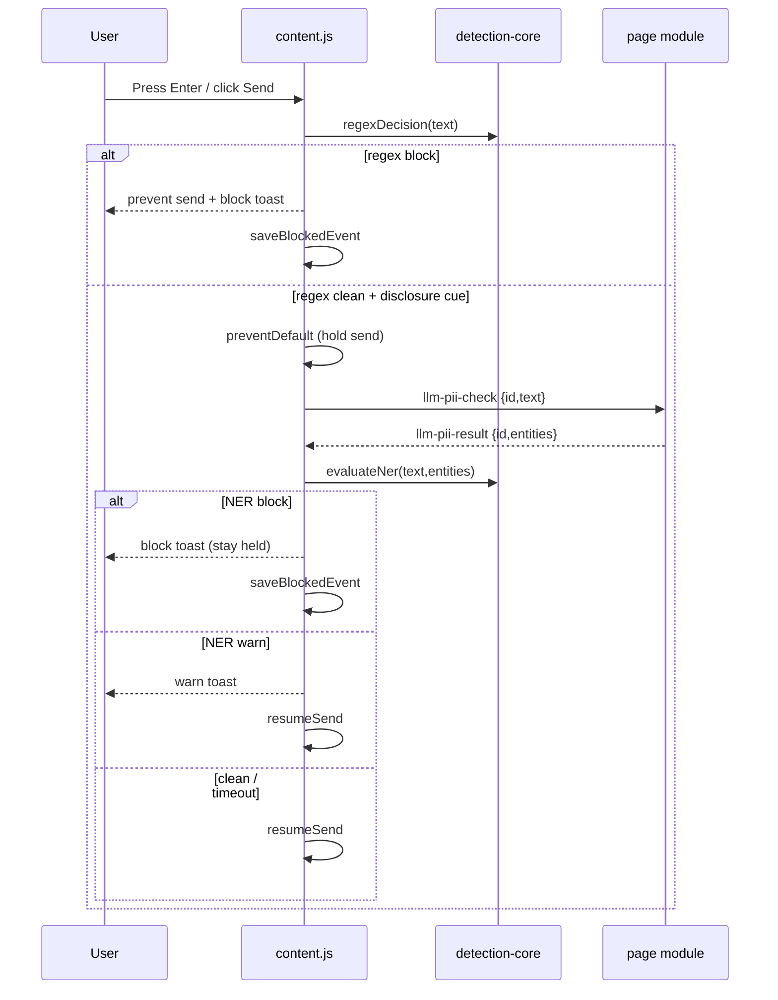

# Low-Level Design (LLD) — LLM Data Leakage Monitor

This document details module internals, function contracts, data structures,
and runtime interactions. It complements `HLD.md`.

## 1. Module map and load order

Content scripts are injected in this order (see `manifest.json`):

```
detection-core.js  ->  site-adapters.js  ->  content.js
```

| File | Export mechanism | Global exposed |
|---|---|---|
| `detection-core.js` | UMD (CommonJS + global) | `LdlmDetection` / `module.exports` |
| `site-adapters.js` | UMD (CommonJS + global) | `LdlmAdapters` / `module.exports` |
| `content.js` | Classic script | none (side effects) |
| `background.js` | Service worker (`importScripts('detection-core.js')`) | `self.LdlmDetection` |
| `libs/page-injected-module.js` | ES module (injected at runtime) | `window.ner` |

---

## 2. `detection-core.js`

### 2.1 Constants

```js
MIN_INPUT_LENGTH        = 6
DEFAULT_NER_MIN_SCORE   = 0.75
```

### 2.2 Data structures

```js
CATEGORY_GROUPS = {
  secrets:  ['AWS Key','Google API Key','Secret Key','JWT Token','Private Key',
             'Connection String','OAuth Token','API Key','Access Token',
             'Password','Sensitive Data'],
  identity: ['SSN','Credit Card','Medical Record','Employee ID',
             "Driver's License",'Passport'],
  tokens:   ['Hash / Token'],
  contact:  ['Email','Phone Number'],
  personal: ['Full Name','Address'],
  ner:      ['PII (NER)','Person','Organization','Location','Named Entity']
}

DEFAULT_GROUP_ACTIONS = {
  secrets:'block', identity:'block', tokens:'warn',
  contact:'warn', personal:'warn', ner:'warn'
}

DEFAULT_SETTINGS = {
  mode:'block', allowlist:[], scope:'llm',
  categoryActions:{ ...DEFAULT_GROUP_ACTIONS }
}
```

- `regexPatterns` — array of RegExp used by `containsSensitiveRegex`.
- `categoryMap` — ordered `[{ pattern, label }]` used to assign a category to a
  match. Order matters: the first matching label wins in `detectCategory`.
- `NER_LABEL_MAP` — maps raw model labels (`LABEL_0..LABEL_8`, `B-/I-` prefixes)
  to canonical types `O | MISC | PER | ORG | LOC`.
- `NER_CATEGORY` — maps canonical NER type to a user-facing category name.
- `HASH_CANDIDATE_RE` — matches 32/40/64-char opaque alphanumeric tokens.
- `SECRET_CONTEXT_RE` — keyword cue regex for the generic-token gate.

### 2.3 Function contracts

| Function | Signature | Behavior |
|---|---|---|
| `shannonEntropy` | `(str) -> number` | Bits/char Shannon entropy of a string |
| `looksLikeSecretToken` | `(token, surroundingText?) -> boolean` | True if a keyword cue is present, else true only for high-entropy (>=3.5) mixed-case+digit tokens; pure-hex without cue is false |
| `detectGenericHash` | `(text) -> boolean` | Extract 32/40/64-char candidates, return true if any passes `looksLikeSecretToken` |
| `containsSensitiveRegex` | `(text) -> boolean` | Any `regexPatterns` match OR `detectGenericHash` |
| `matchingCategories` | `(text) -> string[]` | Distinct category labels; adds `Hash / Token` via gate; falls back to `Sensitive Data` |
| `detectCategory` | `(text) -> string` | First matching category or `Sensitive Data` |
| `mergeSettings` | `(raw) -> Settings` | Normalize/validate stored settings against defaults |
| `categoryGroup` | `(label) -> groupName` | Reverse lookup; defaults to `secrets` |
| `capAction` | `(action, mode) -> action` | `off`→ignore; `warn` mode caps `block`→`warn` |
| `actionForCategory` | `(label, settings) -> action` | Group policy capped by mode |
| `strongestAction` | `(actions[]) -> action` | block > warn > ignore |
| `evaluateRegex` | `(text, settings) -> Verdict` | Synchronous regex verdict |
| `normalizeNerLabel` | `(ent) -> canonicalLabel` | Map an entity's label |
| `hasDisclosureContext` | `(text, nerType) -> boolean` | Disclosure-cue check per NER type |
| `nerIndicatesPii` | `(result, minScore?) -> boolean` | Low-level gate: any non-`O` entity above score |
| `evaluateNer` | `(text, result, settings, minScore?) -> Verdict` | Full NER verdict with disclosure + policy |

### 2.4 Verdict object

```ts
type Verdict = {
  action: 'skip' | 'clean' | 'warn' | 'block',
  category: string | null,
  method: 'regex' | 'bert'
}
```

- `skip` — input below `MIN_INPUT_LENGTH` or out of scope (no decision made).
- `clean` — evaluated, nothing actionable.
- `warn` / `block` — actionable verdict with a category.

### 2.5 `evaluateRegex` flow

```
if !text or len < MIN_INPUT_LENGTH            -> { skip }
hits = matchingCategories(text)
if hits empty                                 -> { clean }
rank each hit via actionForCategory
action = strongestAction(ranked)
return { action (ignore->clean), category: strongest hit, method:'regex' }
```

### 2.6 `evaluateNer` flow

```
merged = mergeSettings(settings)
if result empty                               -> { clean, bert }
for each entity:
  map label; skip if 'O'
  skip if score <= minScore (0.75)
  skip if !hasDisclosureContext(text, type)
  collect NER_CATEGORY[type]
if no hits                                    -> { clean, bert }
rank -> strongestAction -> chosen category
return { action (ignore->clean), category, method:'bert' }
```

---

## 3. `site-adapters.js`

### 3.1 Adapter object (per site)

```ts
type Adapter = {
  id: 'chatgpt' | 'claude',
  hosts: string[],
  composerSelectors: string[],
  sendSelectors: string[],
  getComposer(root?): Element|null,
  getSendButton(root?): Element|null,
  composerFromEvent(event): Element|null,
  sendButtonFromEvent(event): Element|null,
  getText(el?): string,
  submit(): boolean
}
```

### 3.2 Helpers

| Function | Purpose |
|---|---|
| `isDisplayed(el)` | Visibility + not-disabled check via computed style and client rects |
| `queryAll(selectors, root)` | Union of matches across a selector list, tolerant of invalid selectors |
| `lastVisible(selectors, root)` | Last displayed match (else last attached) |
| `closestMatch(el, selectors)` | First `el.closest` hit across selectors |
| `isLikelySendButton(el)` | Heuristic: not a blocked control; matches send label/testid/id/type=submit |
| `isBlockedControl(el)` | Excludes stop/cancel/voice/upload/attach/etc. and disabled controls |
| `hostMatches(hostname, hosts)` | Exact or suffix (`*.host`) match |
| `getFieldText(node)` | `innerText`/`textContent` for contenteditable, else `value` |
| `getAdapter(hostname?)` | Resolve adapter by host or `data-ldlm-adapter` override |
| `isLlmHost(hostname)` | Membership in `LLM_HOSTS` |
| `isLlmContext(hostname?)` | Adapter present, LLM host, or forced adapter attribute |
| `isSendKey(event)` | Enter without Shift, not composing (IME) |

### 3.3 `LLM_HOSTS`

ChatGPT, OpenAI, Claude, Gemini/Bard, Copilot (web + cloud), Grok (grok.com +
grok.x.ai), Perplexity, Poe, You.com, Phind, Character.AI, DeepSeek, Mistral,
Meta AI.

---

## 4. `content.js`

### 4.1 State

```js
settingsCache       // last-known merged settings
passThroughSend     // true while we re-trigger a send we already cleared
sendCheckInFlight   // guards concurrent NER send-holds
lastSendGuardAt     // timestamp to debounce repeat guards
```

### 4.2 Lifecycle

1. Destructure helpers from `window.LdlmDetection` / `window.LdlmAdapters`.
2. `maybeInjectModel()` + `loadSettingsCache()` on load.
3. Listen to `chrome.storage.onChanged` to refresh `settingsCache` and
   re-evaluate model injection.
4. Listen for `llm-model-status` from the page module and relay to the service
   worker via `chrome.runtime.sendMessage({ type:'modelStatus', status })`.
5. `startMonitoring()` attaches listeners and a `MutationObserver` (including
   shadow roots) to wire up dynamically added inputs.

### 4.3 Event handlers (capture phase on `window`)

| Handler | Event | Role |
|---|---|---|
| `onInput` (debounced 700ms) | `input` | Evaluate field text, apply verdict |
| `onPaste` | `paste` | Check clipboard text; block prevents paste |
| `onDrop` | `drop` | Check dropped text; block prevents drop |
| `onKeydownCapture` | `keydown` | Guard Enter-to-send on adapters/monitored fields |
| `onPointerCapture` | `pointerdown` / `click` | Guard send-button clicks |
| `onSubmitCapture` | `submit` | Guard form submits |

### 4.4 Core routines

- `regexDecision(text, settings)` — scope/allowlist/mode gate, then
  `evaluateRegex`. Returns a `Verdict`.
- `processSensitiveText(el, text, source)` — async: regex first, then NER via
  `checkNerWithPage` when `shouldRunNer(text)`. Applies verdict. Returns
  `'block' | 'warn' | false`.
- `guardOutgoing(event, el, text, source, adapter)` — synchronous send gate:
  block → prevent + record; warn → record + allow; regex-clean + disclosure →
  `preventDefault` and `holdForBertThenSend`.
- `holdForBertThenSend(...)` — runs NER with a 2500ms timeout; on block, stops
  the send; on warn/clean, calls `resumeSend(adapter)`.
- `resumeSend(adapter)` — sets `passThroughSend`, clicks the send button or
  dispatches a synthetic Enter, then clears the flag after 50ms.
- `applyVerdict(el, verdict, source, method, text, categoryOverride)` — picks a
  category, calls `blockInput`/`warnOnly`, records the event.
- `saveBlockedEvent(action, source, domain, method, category)` — prepends a
  record to `llmBlockedEvents`, caps at 200.

### 4.5 Model injection

`injectModuleScript()` appends a `<script type="module">` pointing at
`libs/page-injected-module.js`, carrying `data-model-path` and `data-wasm-path`
attributes (resolved via `chrome.runtime.getURL`). Guarded by a
`data-ldlm-ner="1"` marker so it injects once.

---

## 5. `libs/page-injected-module.js` (page context)

### 5.1 Responsibilities

1. Patch `Cache.prototype.put` to swallow `chrome-extension` scheme cache errors.
2. Read `data-model-path` / `data-wasm-path` from its own script tag.
3. Configure Transformers.js `env`: `allowRemoteModels=false`,
   `localModelPath`, `backends.onnx.wasm.wasmPaths`, `useBrowserCache=false`.
4. Build a `token-classification` pipeline for `bert-tiny-ner` (quantized).
5. Dispatch `llm-model-status` (`ready` | `error`).
6. Answer `llm-pii-check` events with `llm-pii-result`, caching the last
   text/result pair.

### 5.2 Event contract (page <-> content script)

| Event | Direction | Detail payload |
|---|---|---|
| `llm-pii-check` | content -> page | `{ id, text }` |
| `llm-pii-result` | page -> content | `{ id, entities: Entity[] }` |
| `llm-model-status` | page -> content | `{ status: 'ready'|'error' }` |

`Entity` shape (from the pipeline, `aggregation_strategy:'simple'`):
`{ entity_group|entity, score, word, start, end }`.

`checkNerWithPage(text, timeoutMs=2500)` in `content.js` correlates request and
response by a random `id`; on timeout it resolves `[]` (fail-open).

---

## 6. `background.js` (MV3 service worker)

### 6.1 Responsibilities

- `onInstalled`: seed `llmLeakageSettings` via `mergeSettings`, reset
  `llmModelStatus='loading'`, sync the dynamic all-sites script.
- `onStartup`: re-sync the dynamic all-sites script.
- `storage.onChanged`: re-sync when `llmLeakageSettings` changes.
- `onMessage`: persist `modelStatus` to `llmModelStatus`.

### 6.2 `syncAllSitesScript(settings)`

```
scope = settings.scope === 'all' ? 'all' : 'llm'
hasPermission = chrome.permissions.contains({ origins:['<all_urls>'] })
isRegistered  = getRegisteredContentScripts(['ldlm-all-sites']).length > 0

if scope === 'all' and hasPermission and !isRegistered:
    registerContentScripts([{ id:'ldlm-all-sites', matches:['<all_urls>'],
      js:['detection-core.js','site-adapters.js','content.js'],
      runAt:'document_start' }])
elif scope !== 'all' or !hasPermission, and isRegistered:
    unregisterContentScripts(['ldlm-all-sites'])
```

Important: `importScripts('detection-core.js')` must stay; no ONNX in the worker
(MV3 cannot spawn `blob:` Web Workers).

---

## 7. `popup.js` and `dashboard.js`

### 7.1 Shared

Both read/write `chrome.storage.local` and call `mergeSettings` before saving.
Both react to `storage.onChanged`.

### 7.2 Scope permission handshake

- Popup checkbox and dashboard scope-select use the click/save user gesture to
  call `chrome.permissions.request({ origins:['<all_urls>'] })` when enabling
  "all sites"; on decline the UI reverts to LLM-only.
- Switching back to LLM-only calls `chrome.permissions.remove`.

### 7.3 Dashboard rendering

- `esc(value)` HTML-escapes all stored values interpolated into `innerHTML`
  (event table, filter options, category/domain bar charts) — defense in depth.
- Canvas renderers: `drawSparkline`, `renderTimeline` (24h), donut via
  `conic-gradient`.
- CSV export builds a quoted CSV blob and triggers a download.

---

## 8. Storage schema (`chrome.storage.local`)

| Key | Type | Shape |
|---|---|---|
| `llmLeakageSettings` | object | `{ mode, scope, allowlist[], categoryActions }` |
| `llmBlockedEvents` | array (<=200) | `{ action, source, domain, detectionMethod, category, time }` |
| `llmModelStatus` | string | `'loading' | 'ready' | 'error'` |

Event record field values:
- `action`: `'Blocked' | 'Warning'`
- `source`: `'input' | 'paste' | 'drop' | 'send' | 'submit'`
- `detectionMethod`: `'regex' | 'bert'`
- `time`: epoch ms

---

## 9. Sequence: send interception with NER hold



---

## 10. Testing hooks

- `detection-core.js` and `site-adapters.js` export pure functions consumed by
  `test_detection_core.js` (unit) and `test_regex_detection.js` (dataset).
- Unit tests cover regex helpers, the generic-token gate, NER decision logic,
  settings merge, policy mapping, and adapter resolution.
- `eslint.config.js` provides per-runtime globals (browser, UMD, worker, Node).
- CI (`.github/workflows/ci.yml`) runs `eslint .` and `npm test` on push/PR.
