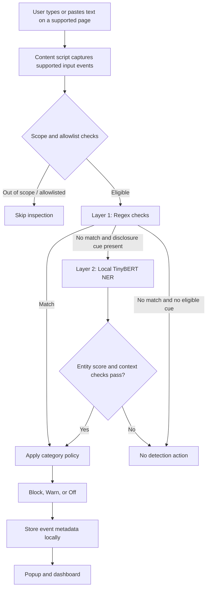

# 🛡️ LLM Data Leakage Monitor

A privacy-first Chrome Manifest V3 extension that helps detect potential sensitive-data leakage when people type into supported AI chat websites. It combines fast, deterministic regular-expression checks with an optional local TinyBERT NER pass for selected disclosure-shaped text.
Privacy model: Detection is designed to run locally in the browser using bundled model assets. The extension is best-effort protection—not a guarantee that every secret or personal detail will be detected. Review the permissions and code before relying on it for sensitive workflows.


At a glance

- Platform: Chrome extension using Manifest V3
- Detection: Regex checks first; local TinyBERT NER fallback for eligible text
- Inference: ONNX Runtime WebAssembly, using local model assets
- Actions: Block, Warn, or Off, with category-level policy settings
- Storage: Local extension storage for event history and settings
- UI: Popup for quick status and dashboard for history, analytics, and CSV export
  
How it works



Layer 1 — Regex checks

The first layer checks recognizable patterns such as email addresses, phone numbers, Social Security numbers, payment-card-like numbers, API keys, JWTs, private-key headers, connection strings, and credential phrases. Pattern matches are fast and deterministic, but a match does not prove that a value is a real or active credential.
The architecture diagram currently documents 24 regex patterns across 15+ categories. Keep that count synchronized with the actual implementation if the pattern set changes.

Layer 2 — Local TinyBERT NER

If the regex layer does not match and the text meets the supported disclosure-context conditions, the extension can run a local TinyBERT named-entity-recognition model through ONNX Runtime WebAssembly. It can identify entity types such as people, organizations, and locations. NER is not a dedicated secret detector, so it may miss secrets and may flag ordinary text.
The current documented confidence threshold is greater than 0.75, alongside disclosure-context checks. This threshold is a decision setting, not a guarantee of accuracy.

Actions and policy

The extension supports Block, Warn, and Off behavior, with category-level policies.
- Block: Attempts to prevent submission and may clear the relevant input, depending on the site adapter and input path.
- Warn: Shows a warning and allows the user to continue.
- Off: Takes no enforcement action for the relevant policy; detection/event behavior depends on the configured path.
- Policy precedence: Warning behavior can cap blocking for the applicable category. Check the dashboard settings for current policy and allowlist behavior.
Site UI changes, unsupported editors, shadow DOM, and timing differences can affect interception. Do not assume every send button or editor on every website is covered.
Site coverage and input handling
The extension is intended for supported AI chat websites, including ChatGPT, Claude, Gemini, Copilot, Grok, Perplexity, Poe, You.com, Phind, Character.AI, DeepSeek, Mistral, and Meta AI. The exact behavior varies by site: ChatGPT and Claude have dedicated site adapters; other sites may receive general input monitoring rather than full send-interception support.
Supported input paths can include typing, paste, drag-and-drop, form submission, and site-specific send actions. Coverage depends on the page structure and adapter implementation. LLM-site-only monitoring is the default; optional all-sites monitoring may be available in settings.

Local storage and privacy

- Detection and model inference are designed to run in the browser without a remote inference service during normal operation.
- The extension uses Chrome extension APIs such as chrome.storage.local and chrome.runtime for local event history, settings, and message passing.
- Event history is documented as retaining up to 200 events.
- The dashboard can show event history and analytics and may export event data as CSV.
- Avoid logging raw prompt contents unless the implementation and user-facing privacy notice explicitly justify it. Verify the current event schema before making stronger claims about exactly which fields are stored.
- A one-time setup/download script may need internet access to fetch the model. Normal offline inference depends on the model assets being present locally.

Model setup

The project documents a pre-trained TinyBERT NER ONNX model sourced from onnx-community/TinyBERT-finetuned-NER-ONNX. The model is used as supplied; this repository documentation does not claim that the model was trained from scratch for this project.
If the model assets are not included in your checkout, use the repository's model setup script (for example, download_model.py) and follow its instructions. The architecture image describes the quantized model as approximately 14.5 MB; verify the actual tracked file name and size against the model path loaded by libs/page-injected-module.js before publishing a release.

## Install the extension

The extension is designed to run locally in Chrome using the bundled JavaScript runtime, tokenizer, TinyBERT ONNX model, and WebAssembly assets. **Node.js and Python are not required to install or use the extension** when the required assets are already present.

1. Clone or download this repository.
2. Open `chrome://extensions` in Chrome or a compatible Chromium browser.
3. Enable **Developer mode**.
4. Click **Load unpacked** and select the project directory containing `manifest.json`.
5. Open the extension popup and visit a supported AI chat website. When protection is enabled and the page is in scope, the extension monitors supported input paths and applies its detection pipeline.
6. Open the dashboard from the popup to review settings, event history, and available analytics.

### Supported websites

The extension is designed to support AI chat websites such as ChatGPT, Claude, Gemini, Copilot, Grok, Perplexity, Poe, You.com, Phind, Character.AI, DeepSeek, Mistral, and Meta AI. The level of input monitoring and submission interception depends on the website adapter and page structure.

LLM-site-only monitoring is enabled by default. Optional all-sites monitoring can be configured through the extension settings.

### Optional: Download or refresh model files

The model assets are intended to be included in the repository. You normally do not need to download them separately.

To restore or refresh the model files, install the downloader dependency and run the provided script from the project root:

```bash
python -m pip install huggingface_hub
python download_model.py
```

The script downloads the model assets from Hugging Face into `web_model/bert-tiny-ner/`. This setup step requires an internet connection. Normal inference is designed to use the local model rather than a remote inference API.

## Run the tests

Node.js and npm are required only for the automated test scripts. Run the following commands from the project root.

### 1. Install dependencies

```bash
npm install
```

### 2. Run unit tests

```bash
npm test
```

This runs the project's automated checks for detection-core behavior, regex and policy helpers, NER decision logic, and site adapters.

### 3. Run the combined detection dataset test

```bash
npm run test:dataset
```

The dataset test evaluates the combined regex and TinyBERT NER detection pipeline using **2,000 synthetic examples**:

- **1,000 expected-positive examples** containing patterns that should be detected.
- **1,000 expected-negative examples** that should not be detected.

In the latest recorded run, the test reported 2,000 correct classifications and 0 incorrect classifications on this dataset. These results describe performance on the project's synthetic test cases only; they are not an independent benchmark or a guarantee of production accuracy.

### 4. Perform manual testing

1. Load the extension through `chrome://extensions`.
2. Open `test_page.html` to test the supported detection behavior.
3. If testing a local file, enable **Allow access to file URLs** in the extension details.
4. Test regex matches, warning and blocking policies, and supported input paths using synthetic examples.

**Important:** Do not use real passwords, active API keys, or confidential personal information for testing. Website changes, unsupported editors, and input paths can affect detection coverage.


Project structure

Names can vary slightly by branch; the main documented components include:
| Component | Responsibility |
|---|---|
| `manifest.json` | Extension manifest and permissions |
| `content.js` | Input monitoring, detection coordination, and enforcement |
| `detection-core.js` | Regex and shared detection logic |
| `site-adapters.js` | Site-specific input/send handling |
| `background.js` | Extension-wide message and state handling |
| `libs/page-injected-module.js` | Local ONNX model inference bridge |
| `web_model/bert-tiny-ner/` | Local NER model assets |
| `popup.html` and related scripts | Quick status and controls |
| Dashboard files | Event history, analytics, settings, and CSV export |
| `test_detection_core.js` / `test_regex_detection.js` | Detection tests |
| `test_questions.json` | Synthetic dataset used by the dataset test |
| `download_model.py` | Optional model setup/download helper |


Check the current repository tree for the exact filenames present in your branch.

Limitations

- Regex checks only detect patterns represented by their rules and can produce false positives or miss variants.
- NER detects named entities, not every kind of confidential information.
- Disclosure-context gating can reduce irrelevant entity detections but can also miss sensitive content outside supported contexts.
- Website changes, custom editors, shadow DOM, unsupported input paths, and browser restrictions may reduce coverage.
- The extension is a best-effort client-side aid, not a substitute for security review, data-loss-prevention controls, or careful handling of confidential information.

  
Technology

- JavaScript and Chrome Extensions Manifest V3
- Regular expressions and site-specific content scripts
- TinyBERT NER and ONNX Runtime WebAssembly
- Chrome extension storage and runtime messaging
- HTML/CSS/JavaScript dashboard and test scripts

Responsible use

Use synthetic test data while developing. Do not rely on this extension as the only safeguard for confidential data, and do not interpret a successful test run as proof that all leakage paths are blocked.
