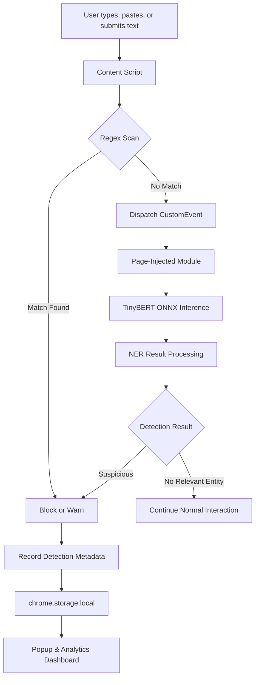

<h1 align="center"> # 🛡️ LLM Data Leakage Monitor </h1>

<strong>Privacy-First. AI-Powered. Entirely Local.</strong>
  <br/>
  A Chrome extension that detects and prevents accidental exposure of sensitive information before it reaches AI chat interfaces.
</p>

<p align="center">
  
  
  
  
  
</p>

<p align="center">
  
</p>

---

## 📌 Overview

**LLM Data Leakage Monitor (LDLM)** is a privacy-focused Chrome extension designed to detect sensitive information before it is submitted to AI assistants such as ChatGPT, Claude, and Gemini.

It combines deterministic pattern matching with lightweight, locally executed NLP inference to identify potential data leaks directly in the browser.

Instead of sending user input to an external security service, LDLM processes detection requests locally and applies configurable protection policies.

### Why LDLM?

As AI assistants become part of everyday development and productivity workflows, users may unintentionally paste API keys, passwords, personal information, database credentials, or confidential text into AI prompts.

Traditional pattern matching catches recognizable secrets but can miss contextual information. ML-based detection can identify certain named entities that do not match predefined patterns.

LDLM combines both approaches in a single browser-based protection layer.

**Core principle:** Detect locally. Protect before submission. Keep sensitive content on the user's device.

## ✨ Key Features

| Feature | Description |
|---|---|
| 🔍 Hybrid Detection | Regex scanning followed by local TinyBERT NER inference |
| ⚡ Real-Time Monitoring | Monitors supported text inputs and content-editable fields |
| 🔐 Privacy-First Architecture | No external inference API or telemetry server |
| 🚫 Block Mode | Clears detected input and displays a warning |
| ⚠️ Warn Mode | Highlights suspicious input and displays a warning |
| 📊 Analytics Dashboard | Visualizes detection activity, categories, and target domains |
| 🧾 Event History | Stores up to 200 detection events locally |
| ⚙️ Configurable Protection | Switch modes, manage trusted domains, or disable detection |
| 📤 CSV Export | Export recorded detection metadata |
| 🧪 Automated Tests | Includes a 200-case labeled test dataset |
| 🌐 Offline Inference | Runs the local ONNX model using WebAssembly |

## 🧠 Project Type: Applied Machine Learning

LDLM is an **applied ML and browser-security project**, not a generative AI application.

It integrates a pretrained, fine-tuned TinyBERT model for Named Entity Recognition (NER) into a client-side security workflow. The model is used as-is; custom model training is not part of the current implementation.

The detection system has two layers:

**Layer 1 — Regex Engine**

Scans text against predefined patterns for structured secrets and personal information. This provides fast, deterministic detection for supported formats.

**Layer 2 — TinyBERT NER**

Processes text using a local ONNX model to identify named entities that may be missed by regex, such as people, organizations, and locations, depending on the model's learned labels and the extension's post-processing logic.

The extension combines these signals with its configured protection mode to decide how to handle suspicious input.

> **Important distinction:** The pretrained model is a general NER model, not a dedicated classifier trained specifically on API keys, passwords, or every category of PII. Regex handles the explicitly defined secret patterns, while NER provides complementary entity detection. Detection accuracy depends on the patterns, model labels, and decision logic.

## ⚙️ How It Works



### Detection Pipeline

1. **Monitor:** The content script observes supported text-entry elements.
2. **Inspect:** Input is checked against 26 regex patterns.
3. **Escalate:** If regex does not match, the text is passed to the local NER inference module.
4. **Evaluate:** The inference result is interpreted by the extension's detection logic.
5. **Protect:** Depending on the mode, the extension blocks or warns about suspicious input.
6. **Record:** Detection metadata is stored in `chrome.storage.local`.
7. **Visualize:** The popup and dashboard display detection statistics and event history.

**Why run inference in the page context?**

The project uses a page-injected ES module to execute local ONNX inference. This avoids loading the model into the Chrome Manifest V3 background service worker, where service-worker lifecycle and worker restrictions complicate the inference setup. The background script instead handles extension lifecycle events and model-status communication.

The inference module uses locally bundled JavaScript and WebAssembly assets.

## 🔬 Model Details

| Property | Details |
|---|---|
| Hugging Face repository | [`onnx-community/TinyBERT-finetuned-NER-ONNX`](https://huggingface.co/onnx-community/TinyBERT-finetuned-NER-ONNX) |
| Original base checkpoint | [`adel-cybral/TinyBERT-finetuned-NER`](https://huggingface.co/adel-cybral/TinyBERT-finetuned-NER) |
| Architecture | Four-layer TinyBERT |
| Model task | Named Entity Recognition / token classification |
| Output labels | `LABEL_0` through `LABEL_8` |
| Model format | Quantized ONNX |
| Runtime | ONNX Runtime WebAssembly |
| Approximate model size | 36 MB |
| Fine-tuning in this project | None |
| Inference location | Browser, using local model assets |
| External inference APIs | None |

### Why TinyBERT?

TinyBERT provides a compact transformer architecture suitable for resource-constrained inference compared with larger transformer models.

In LDLM, it complements regex-based detection by identifying certain contextual entities, while ONNX Runtime enables model execution in a browser environment.

### Future Model Improvements

Potential improvements include:

- Fine-tuning a token-classification model on a properly labeled, PII-focused dataset.
- Adding dedicated detection for API secrets, credentials, and organization-specific identifiers.
- Evaluating precision, recall, F1-score, and false-positive rates by category.
- Benchmarking inference latency, memory usage, and model size.
- Calibrating confidence thresholds and entity-label mappings.

## 🔍 Detection Capabilities

### Layer 1 — Regex Detection

The extension implements **26 regex patterns spanning 15+ sensitive-data categories**.

| Category | Examples |
|---|---|
| Personal Information | Email addresses, phone numbers, SSNs |
| Payment Information | Visa, Mastercard, American Express, Discover card formats |
| Cloud Credentials | AWS access-key patterns and supported Google API-key patterns |
| Authentication Secrets | JWTs, bearer tokens, OAuth tokens, secret keys |
| Cryptographic Material | PEM-formatted private keys |
| Database Credentials | MongoDB, PostgreSQL, MySQL, Redis connection strings |
| Identity Information | Medical record numbers, employee IDs, driver's licenses, passports |
| Sensitive Phrases | Patterns such as `My password is ...` and `My name is ...` |

Regex rules are deterministic for their supported formats. A matching pattern does not necessarily establish that a value is valid, active, or genuinely confidential.

### Layer 2 — TinyBERT NER

When the regex layer does not identify a match, the extension can pass the text to the locally hosted NER model.

This layer provides complementary entity detection for supported labels, including potentially relevant people, organizations, and locations.

NER is not a universal secret detector. Its output depends on the model's training data, label mapping, and the extension's post-processing logic.

### Protection Modes

| Mode | Behavior |
|---|---|
| **Block** | Clears the affected field and displays a red warning |
| **Warn** | Highlights the field in amber and displays a warning |
| **Off** | Disables detection |

Regex matches can be handled synchronously. BERT-only results require inference time, so the field-clearing behavior may occur after inference rather than before the original input event completes.

## 📊 Interactive Analytics Dashboard

The full-page dashboard provides visibility into detection activity without requiring users to inspect the browser console.

### Dashboard Overview

- Animated header with gradient typography and a protection-status indicator.
- Six statistic cards covering blocked events, warnings, recent activity, protected sites, BERT detections, and top categories.
- Seven-day sparkline trends for supported statistics.
- A 24-hour activity timeline using hourly buckets.
- Category distribution bar chart.
- Regex-versus-BERT detection-method donut chart.
- Top-targeted-domains chart.
- Last-updated timestamp refreshed every 30 seconds.

### Event Log

- Detection history with a limit of 200 stored events.
- Color-coded blocked and warned records.
- Expandable event details.
- Filters for action, method, category, and domain.
- CSV export with export-status feedback.
- Clear-all control.

### Settings

- Block, Warn, and Off mode selection.
- Domain allowlist management.
- Extension status information.
- Quick enable/disable control.

### Popup

The compact extension popup provides:

- Model status: Loaded, Loading, or Failed.
- Blocked, warned, and recent-activity counters.
- One-click Block, Warn, and Off controls.
- A list of the five most recent detections.
- An Open Full Dashboard action.

## 🏗️ Project Structure

```text
llm-data-leakage-monitor/
│
├── manifest.json
├── background.js
├── content.js
│
├── popup.html
├── popup.js
│
├── dashboard.html
├── dashboard.js
├── dashboard_preview.html
│
├── test_page.html
├── test_regex_detection.js
├── test_questions.json
│
├── download_model.py
│
├── web_model/
│   └── bert-tiny-ner/
│       └── onnx/
│           └── model_quantized.onnx
│
├── wasm/
│   └── ONNX Runtime WebAssembly assets
│
└── libs/
    ├── transformers.min.js
    └── page-injected-module.js
```

| File / Directory | Responsibility |
|---|---|
| `manifest.json` | Chrome Manifest V3 configuration and permissions |
| `background.js` | Extension lifecycle and model-status relay |
| `content.js` | Input monitoring, regex checks, protection logic, and event logging |
| `page-injected-module.js` | Local transformer initialization and ONNX inference |
| `popup.js` | Popup controls and recent-event summaries |
| `dashboard.js` | Analytics, charts, filters, settings, and event history |
| `dashboard_preview.html` | Standalone dashboard preview with mock data |
| `test_page.html` | Manual detection testing |
| `test_regex_detection.js` | Automated test runner |
| `test_questions.json` | 200 labeled test cases |
| `download_model.py` | Downloads and prepares the ONNX model |
| `web_model/` | Local model assets |
| `wasm/` | WebAssembly runtime assets |
| `libs/transformers.min.js` | Bundled transformer library |

## 🚀 Installation & Setup

### Prerequisites

- Google Chrome or another compatible Chromium-based browser.
- Node.js and npm.
- Python 3 and pip.
- Internet access for the initial model download.

### 1. Clone the repository

```bash
git clone <YOUR_REPOSITORY_URL>
cd llm-data-leakage-monitor
```

Replace `<YOUR_REPOSITORY_URL>` with your repository URL.

Alternatively, download the repository and extract it locally.

### 2. Install JavaScript dependencies

```bash
npm install
```

### 3. Install the model downloader dependency

```bash
python -m pip install huggingface_hub
```

### 4. Download the ONNX model

```bash
python download_model.py
```

The script downloads the quantized model from Hugging Face and places it under:

```text
web_model/bert-tiny-ner/onnx/model_quantized.onnx
```

It also handles the documented legacy model-filename variation.

### 5. Load the extension into Chrome

1. Open `chrome://extensions/`.
2. Enable **Developer mode**.
3. Select **Load unpacked**.
4. Choose the project directory containing `manifest.json`.
5. Confirm that the extension appears in the toolbar.

### 6. Verify the installation

Click the extension icon and check the model status.

Open the full dashboard to review the configured protection mode and detection history.

**Note:** The browser extension requires its referenced local model and runtime files to be present. The dashboard preview can be opened separately without installing the extension.

## 🧪 Testing

### Manual Testing

Open `test_page.html` in Chrome and try the following sample inputs in supported fields.

| Test Input | Expected Regex Category |
|---|---|
| `test@example.com` | Email |
| `AKIA1234567890ABCDEF` | AWS access-key pattern |
| `My SSN is 123-45-6789` | SSN |
| `My password is example123` | Password phrase |
| A test database connection string | Database credentials |

Use synthetic test data only. The examples are intended to exercise pattern matching and do not represent real credentials.

### Automated Testing

Run the Node.js test script:

```bash
node test_regex_detection.js
```

The repository includes 200 labeled test cases. Review the test runner's output for its accuracy report and individual failures.

**Evaluation note:** The reported results depend on the test dataset, expected labels, and implementation of the runner. They should not be interpreted as independent evidence of production accuracy without additional evaluation.

### Suggested Evaluation Metrics

For a stronger ML evaluation, measure:

- Precision and recall by sensitive-data category.
- F1-score for the overall detection pipeline.
- False-positive and false-negative rates.
- Regex-only versus combined-pipeline performance.
- Median and 95th-percentile inference latency.
- Browser memory consumption and model initialization time.

### Troubleshooting

**Model not found**

```bash
python download_model.py
```

**Model fails to load**

- Verify that the ONNX file exists at the expected path.
- Check the browser console for model-loading or WebAssembly errors.
- Confirm that the referenced JavaScript and runtime files are present.
- Reload the extension after correcting the issue.

**Extension fails to load**

- Inspect `manifest.json` for missing paths or invalid permissions.
- Open the extension's error details in `chrome://extensions/`.
- Check the console for JavaScript errors.

## 🔐 Privacy & Security

Privacy is a core design requirement of LDLM.

- **Local inference:** The ONNX model runs inside the browser.
- **No inference API:** User text is not sent to a remote AI or classification service by the detection pipeline.
- **Local event storage:** Detection history is stored in `chrome.storage.local`.
- **Bundled runtime:** Transformer and WebAssembly assets are loaded locally.
- **Initial setup download:** The model is downloaded from Hugging Face during setup.
- **Configurable protection:** Users can choose their detection mode and trusted domains.

### Important Limitations

LDLM is a defense-in-depth tool, not a guarantee against every form of data leakage.

- Regex rules only detect supported formats and may produce false positives or miss unfamiliar formats.
- General-purpose NER models may fail to identify sensitive information and may label ordinary text as an entity.
- Page-specific JavaScript behavior, shadow DOM, custom editors, and unsupported input paths can affect coverage.
- Asynchronous inference creates a timing difference between regex-based blocking and ML-based detection.
- A domain allowlist intentionally bypasses protection on configured trusted domains.
- Local event history can contain sensitive metadata, depending on the fields recorded by the implementation.
- Disabling the extension or using an unsupported browser context removes or limits its protection.

The local-first design reduces unnecessary external data exposure, but its effectiveness still depends on the implementation, browser permissions, and detection coverage.

## 🛠️ Technology Stack

| Area | Technologies |
|---|---|
| Browser Extension | JavaScript, Chrome Extensions API, Manifest V3 |
| Pattern Detection | Regular expressions |
| Natural Language Processing | TinyBERT, Named Entity Recognition |
| Model Format | ONNX, quantized model |
| Inference Runtime | ONNX Runtime WebAssembly |
| Transformer Runtime | `@xenova/transformers` v2 |
| Browser Communication | CustomEvent, `dispatchEvent` |
| Dynamic DOM Monitoring | MutationObserver |
| Local Persistence | `chrome.storage.local` |
| Dashboard | HTML, CSS, JavaScript, Canvas API |
| Automated Testing | Node.js |
| Model Setup | Python, `huggingface_hub` |

## 🧩 Engineering Challenges & Fixes

| Challenge | Resolution |
|---|---|
| Remote library imports incompatible with Manifest V3 restrictions | Bundled the transformer library locally |
| Background service worker crashes during model initialization | Moved inference out of the service worker |
| Incorrect entity-label assumptions | Updated processing to use the model's `LABEL_0`–`LABEL_8` outputs |
| Overly broad identity-document patterns | Tightened supported label-prefix requirements |
| Secret patterns failed on common assignment phrases | Added support for `:`, `=`, and `is` |
| Asynchronous inference delayed input handling | Separated synchronous regex handling from asynchronous ML results |
| Browser caching configuration was ineffective | Replaced the ineffective setting with the supported configuration |
| Inline popup scripts conflicted with extension CSP | Moved popup logic into `popup.js` |
| Model filename inconsistencies | Added filename handling to the download script |
| Unused helper code | Removed the obsolete `set-globals.js` file |

## 🔮 Future Scope

- Develop a dedicated PII and secret-detection model.
- Add configurable sensitivity thresholds and category-level policies.
- Improve support for complex editors and dynamically generated input fields.
- Introduce a more detailed false-positive review workflow.
- Add user-configurable organization policies.
- Benchmark inference latency across devices and browsers.
- Expand the test dataset with representative, synthetic edge cases.
- Add regression tests for browser-specific behavior and submission interception.
- Explore privacy-preserving, local policy updates without uploading user text.

## 🎯 Project Impact

LDLM demonstrates how lightweight NLP, deterministic pattern matching, and browser-extension engineering can be combined to address a practical AI security problem.

The project brings together:

- Applied machine learning and transformer inference.
- ONNX model deployment in a browser environment.
- Client-side security and privacy engineering.
- Real-time input monitoring and event handling.
- Analytics dashboards and local event storage.
- Automated testing and model evaluation.

It illustrates an important principle for AI-assisted workflows: **sensitive-data protection can be implemented at the point of input without requiring a remote inference service.**

## 👨‍💻 Author

**Vedant Atri**

B.Tech | Machine Learning | NLP | AI Security

Interested in applied machine learning, intelligent systems, privacy engineering, and practical AI applications.

---

<p align="center">
  <strong>Built to make AI-assisted workflows safer, one prompt at a time. 🔒</strong>
</p>
