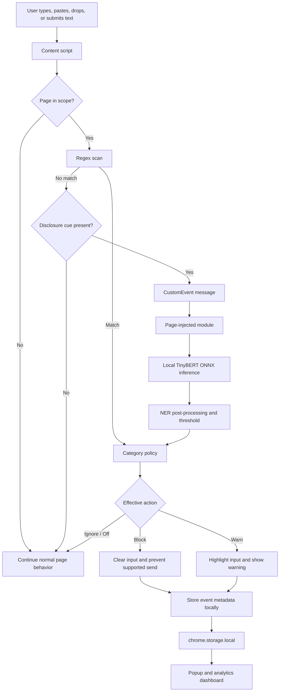

::: {align="center"}
# 🛡️ LLM Data Leakage Monitor

### A local-first security layer for AI-assisted work

**Detect sensitive data before it leaves your browser --- with
deterministic rules, contextual NER, and configurable protection.**

```{=html}
<p>
```
``{=html}
``{=html}
``{=html}
``{=html}
``{=html}
```{=html}
</p>
```
[Overview](#-overview) · [Architecture](#-architecture) ·
[Detection](#-detection-engine) · [Install](#-installation) ·
[Testing](#-testing) · [Security](#-privacy-and-security)
:::🔎 Overview
LLM Data Leakage Monitor (LDLM) is a Chrome extension that helps
prevent accidental disclosure of sensitive information in AI chat
prompts. It checks supported input fields in the browser and applies
user-configurable actions before detected content is submitted.
LDLM combines two complementary techniques:
- Regex detection for recognizable patterns such as supported
  credentials, tokens, and identity data.
- Local TinyBERT Named Entity Recognition (NER) for certain
  people, organizations, and locations when the text contains a
  disclosure cue.
The extension is designed around a simple principle:
Inspect locally. Apply policy at the point of input. Keep detection
content on the device.

LDLM does not send prompt text to a remote inference API as part of its
detection pipeline. The model and runtime assets are downloaded or
bundled for local execution.
Scope by default: LDLM monitors supported AI chat sites by
default. Optional all-sites coverage can be enabled in settings.
Dashboard figures in the architecture illustration are illustrative,
not benchmark results.

✨ What it does
  Capability                          How it works
  Hybrid detection                    Runs deterministic regex checks
                                      and, when eligible, local NER
  Input monitoring                    Observes supported text inputs,
                                      textareas, and content-editable
                                      elements
  Send protection                     Capture-phase Enter / Send / submit
                                      interception on supported ChatGPT
                                      and Claude composers
  Configurable policy                 Supports Block, Warn, and Off modes
                                      plus category-level actions
  Coverage controls                   LLM-sites-only default scope or
                                      optional all-sites monitoring
  Local inference                     Executes the quantized ONNX model
                                      in the browser using ONNX Runtime
                                      WebAssembly
  Event history                       Stores up to 200 detection events
                                      locally
  Analytics dashboard                 Shows detection activity,
                                      categories, domains, and method
                                      breakdowns
  Export                              Exports recorded event metadata as
                                      CSV
  Testable logic                      Shares detection helpers between
                                      extension logic and Node-based
                                  tests
🏗️ Architecture

Architecture overview. Dashboard numbers shown in the diagram are
sample values.
Request lifecycle

Detection sequence
1. Scope check --- by default, run on supported AI chat sites;
   all-sites coverage is optional.
2. Input capture --- monitor supported text-entry elements and
   supported send actions.
3. Regex evaluation --- inspect text using the patterns defined in
   detection-core.js.
4. Policy resolution --- map the detected category to Block, Warn,
   or Ignore, subject to the global mode.
5. Context gate --- if regex does not match, only send text to NER
   when disclosure context is present.
6. Local NER --- use the page-injected module and local ONNX
   assets; post-processing checks the entity label and confidence
   score.
7. Protection action --- block or warn according to the effective
   policy.
8. Local event recording --- save detection metadata to
   chrome.storage.local.
9. Review --- view history and aggregate statistics in the popup or
   dashboard.
Why inference runs in the page context
The project runs its local inference module in the page context rather
than loading the model into the Manifest V3 background service worker.
The background script handles extension lifecycle and model-status
communication, while the page-injected module uses the locally bundled
transformer and WebAssembly assets.
🧠 Detection engine
Layer 1 --- Regex
Regex provides fast, deterministic checks for supported formats. The
current README documents 24 regex scan patterns in
detection-core.js; verify this count against the implementation
whenever patterns change.
Supported examples include:
- Email addresses, phone numbers, and SSN-like formats
- Payment-card number formats
- AWS access-key patterns and supported Google API-key patterns
- JWTs, bearer tokens, OAuth tokens, and secret-key patterns
- PEM-formatted private keys
- MongoDB, PostgreSQL, MySQL, and Redis connection strings
- Selected identity-document formats and sensitive disclosure phrases
A regex match indicates that text resembles a supported pattern; it does
not prove that a credential is valid, active, or confidential.
Layer 2 --- TinyBERT NER
When regex does not match and the input contains a disclosure cue, LDLM
can pass the text to the locally executed TinyBERT NER model.
The post-processing described by the project:
- Reads aggregated entity_group or token-level entity outputs.
- Maps model labels such as LABEL_0--LABEL_8 to supported entity
  groups.
- Ignores outside labels (LABEL_0 / O).
- Requires a confidence score greater than 0.75.
- Requires disclosure context, helping avoid treating every ordinary
  mention of a person, company, or city as a leak.
Important: TinyBERT is a general-purpose NER model, not a dedicated
detector trained to recognize every secret or PII type. Regex remains
responsible for explicitly defined secret formats. NER adds a limited,
contextual entity signal.
Protection modes
  Mode                                Behavior
  Block                           Applies category policy.
                                      Block-level detections clear the
                                      field and prevent supported
                                      submission; warn-level categories
                                      can still warn.
  Warn                            Downgrades detections to warnings
                                      and allows submission.
  Off                             Disables detection actions.
Default category behavior documented for the project:
  Category group          Example data               Typical default action
  Secrets                 API keys, JWTs, private    Block
                          keys, passwords, database
                          URLs                       
  Identity                SSN-like values, cards,    Block
                          passport or medical-ID
                          patterns                   
  Tokens                  Generic long               Warn
                          hexadecimal/alphanumeric
                          strings                    
  Contact                 Email addresses and phone  Warn
                          numbers                    
  Personal                Disclosure phrases         Warn
                          involving names or
                          addresses                  
  NER                     Person, organization, or   Warn
                          location entities in
                      disclosure context         
The dashboard allows policy configuration. The effective result depends
on global mode, category policy, coverage settings, allowlisted domains,
and the detection path.
📊 Dashboard and popup
The full-page dashboard is intended to help users understand local
detection activity without inspecting the browser console.
Dashboard
- Summary cards for blocked events, warnings, recent activity,
  protected sites, NER detections, and top categories
- Seven-day trends and a 24-hour activity timeline
- Category distribution and regex-versus-NER breakdowns
- Top-targeted-domain chart
- Event history with a limit of 200 records
- Filters for action, method, category, and domain
- Expandable event details and CSV export
- Settings for global mode, coverage, category policy, trusted
  domains, and extension status
Popup
- Model status: Loaded, Loading, or Failed
- Blocked, warned, and recent-activity counters
- Quick Block, Warn, and Off controls
- LLM-sites-only coverage toggle
- Five most recent detections
- Link to the full dashboard
🔬 Model card
  Property                            Details
  Model family                        TinyBERT
  Task                                Named Entity Recognition / token classification
  Model source                        onnx-community/TinyBERT-finetuned-NER-ONNX
  Original checkpoint                 adel-cybral/TinyBERT-finetuned-NER
  Format                              Quantized ONNX
  Runtime                             ONNX Runtime WebAssembly
  Confidence threshold                Score > 0.75 after aggregation
  Fine-tuning in this repository      None documented
  Inference location                  Browser, using local assets
  External inference API              Not used by the detection pipeline
The source README describes the checked-in quantized model as
approximately 14.5 MB. Confirm the actual file size in the
repository before treating this as a release artifact specification.
🧰 Technology stack
<p>
{=html}
{=html}
{=html}
{=html}
{=html}
{=html}
</p>
  Area                                Technologies
  Browser extension                   JavaScript, Chrome Extensions API,
                                      Manifest V3
  Pattern detection                   Regular expressions
  NLP                                 TinyBERT NER
  Model format                        Quantized ONNX
  Inference                           ONNX Runtime WebAssembly
  Browser communication               CustomEvent, dispatchEvent,
                                      chrome.runtime messaging
  Site handling                       ChatGPT and Claude composer/send
                                      adapters
  Dynamic page monitoring             MutationObserver
  Local persistence                   chrome.storage.local
  UI                                  HTML, CSS, JavaScript, Canvas API
  Testing                             Node.js
  Model setup                         Python, huggingface_hub
📁 Repository structure
LLM_DATA_LEAKAGE_MONITOR/
├── manifest.json
├── background.js
├── content.js
├── detection-core.js
├── site-adapters.js
├── popup.html
├── popup.js
├── dashboard.html
├── dashboard.js
├── dashboard_preview.html
├── architecture.jpg
├── test_page.html
├── test_detection_core.js
├── test_regex_detection.js
├── test_questions.json
├── download_model.py
├── web_model/
│   └── bert-tiny-ner/
│       └── onnx/
│           └── model_quantized.onnx
├── wasm/
└── libs/
    ├── transformers.min.js
    └── page-injected-module.js
  File                                Responsibility
  manifest.json                     Manifest V3 configuration and
                                      permissions
  background.js                     Extension lifecycle, settings
                                      initialization, and model-status
                                      relay
  content.js                        Input monitoring, send
                                      interception, protection, and event
                                      logging
  detection-core.js                 Shared regex, category-policy, and
                                      NER decision helpers
  site-adapters.js                  Supported composer/send selectors
                                      and LLM host handling
  libs/page-injected-module.js      Local transformer initialization
                                      and ONNX inference
  popup.js                          Popup controls and recent-event
                                      summaries
  dashboard.js                      Analytics, charts, filters,
                                      settings, and event history
  test_detection_core.js            Unit checks for shared detection
                                      logic and adapters
  test_regex_detection.js           Regex/NER dataset runner
  test_questions.json               Labeled test cases
  download_model.py                 Downloads/prepares the model when
                                  required
🚀 Installation
Requirements
- Google Chrome or a compatible Chromium-based browser
- Node.js and npm to run the JavaScript tests
- Python 3 and huggingface_hub only if model assets need to be
  downloaded or refreshed
1. Get the repository
git clone https://github.com/RevHeadGuy/LLM_DATA_LEAKAGE_MONITOR.git
cd LLM_DATA_LEAKAGE_MONITOR
2. Install test dependencies
npm install
The extension's browser runtime assets are bundled in the repository;
npm is used for the Node-based test scripts.
3. Check model assets
The repository is intended to include the local model and runtime files.
If the model is missing or needs refreshing:
python -m pip install huggingface_hub
python download_model.py
The expected model path is:
web_model/bert-tiny-ner/onnx/model_quantized.onnx
Downloading or refreshing model assets requires internet access. Normal
inference is intended to run locally after the required assets are
present.
4. Load the extension
1. Open chrome://extensions/ in Chrome.
2. Enable Developer mode.
3. Click Load unpacked.
4. Select the repository directory containing manifest.json.
5. Pin the extension if you want quick access from the toolbar.
5. Verify
1. Open the extension popup and inspect model status.
2. Open ChatGPT or Claude and try synthetic test inputs.
3. Open the dashboard and verify mode, coverage, category policies, and
   event history.
4. If testing test_page.html from disk, enable Allow access to file
   URLs for the extension.
🧪 Testing and evaluation
Run the shared-logic tests:
npm test
Run the labeled dataset pipeline:
npm run test:dataset
The dataset runner requires the local ONNX model. Use synthetic values
only when testing secrets and identity patterns.
The repository includes a labeled test dataset, but results depend on
its coverage, expected labels, and the runner implementation. Do not
interpret a test pass rate as independent evidence of production-grade
detection.
Recommended evaluation metrics
For a more rigorous evaluation, report:
- Precision, recall, and F1 by sensitive-data category
- False-positive and false-negative rates
- Regex-only versus combined regex + NER performance
- Median and 95th-percentile inference latency
- Model initialization time and memory consumption
- Send-interception regression results across supported sites
🔐 Privacy and security boundaries
LDLM is designed to reduce unnecessary external exposure by processing
detection locally.
- Prompt text is not sent to a remote inference/classification API by
  the detection pipeline.
- The model, transformer runtime, and WebAssembly assets are intended
  to run locally.
- Detection history is stored in chrome.storage.local.
- Initial model download or refresh requires internet access.
- The extension's protection depends on browser permissions, page
  coverage, configuration, and supported input paths.
Limitations to understand
- Regex recognizes supported patterns; it can miss unfamiliar formats
  and can produce false positives.
- General-purpose NER is not a universal PII or secret detector.
- Disclosure gating and confidence thresholds reduce some false
  positives but can miss sensitive data.
- Dedicated ChatGPT and Claude adapters depend on page selectors that
  can change.
- Other AI sites may have regex coverage without dedicated send
  interception.
- Shadow DOM, custom editors, page-specific scripts, and unsupported
  browser contexts can affect coverage.
- NER inference is asynchronous and can delay a disclosure-shaped
  send.
- Allowlisted domains intentionally bypass protection according to the
  configured behavior.
- Local event history can contain sensitive metadata depending on what
  the implementation records.
- Disabling the extension removes its protection.
LDLM is a defense-in-depth aid, not a guarantee that every sensitive
disclosure will be detected or blocked.
🧩 Engineering decisions
  Challenge                           Approach
  MV3 service-worker lifecycle        Keep inference in a page-injected
  complicates model execution         module
  Remote runtime loading conflicts    Bundle transformer and WebAssembly
  with extension restrictions         assets locally
  Test and runtime decision logic can Share helpers through
  drift                               detection-core.js
  Ordinary entity mentions can        Require disclosure context and
  trigger noisy results               apply a confidence threshold
  AI chat composers have different    Use site-specific adapters where
  DOM structures                      implemented
  Send events may fire before         Intercept supported send paths in
  debounced input checks              the capture phase
🗺️ Roadmap
Potential next steps --- not claims of existing functionality:
- Train or fine-tune a dedicated PII and secret-detection model on a
  carefully labeled dataset
- Add browser-level regression tests for send interception
- Expand evaluation with synthetic edge cases and category-level
  metrics
- Benchmark inference latency and memory across devices
- Improve coverage through additional site-specific composer adapters
- Add a user feedback path for false positives
- Explore redacted event details while avoiding unnecessary storage of
  raw sensitive text
🤝 Contributing
Contributions that improve detection quality, privacy, accessibility,
compatibility, or test coverage are welcome.
1. Create a feature branch.
2. Make a focused change and add or update tests.
3. Run npm test and, when relevant, npm run test:dataset.
4. Describe the behavior change, limitations, and validation performed
   in the pull request.
5. Never include real credentials, personal data, or private production
   prompts in tests or screenshots.
👨‍💻 Author
Vedant Atri
B.Tech · Machine Learning · NLP · AI Security
Interested in applied machine learning, intelligent systems, privacy
engineering, and practical AI applications.
- GitHub: @RevHeadGuy
- Project:
  LLM_DATA_LEAKAGE_MONITOR
::: {align="center"}
**Built to make AI-assisted workflows safer --- one prompt at a time.
🔒**

`<sub>`{=html}Local-first by design. Explicit about limitations. Built
for practical browser security.`</sub>`{=html}
:::

