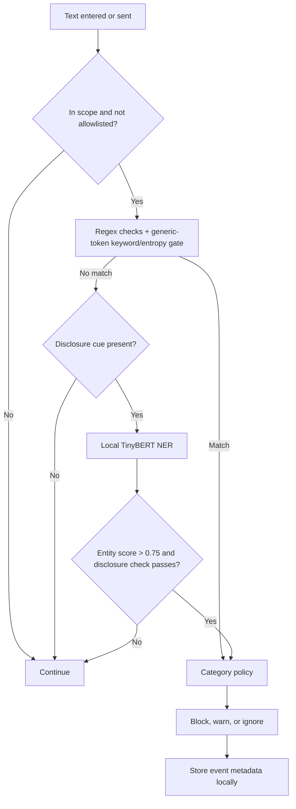

# 🛡️ LLM Data Leakage Monitor

A local-first Chrome extension that checks text entered into AI chat sites for common secrets and sensitive personal information. It combines fast pattern matching with optional, in-browser named-entity recognition (NER) to help catch accidental disclosures before they are sent.

> **Privacy model:** Detection runs in the browser using bundled assets. The extension does not send prompt text to a remote inference service. Detection is best-effort and cannot guarantee that every sensitive value will be caught.


## What it does

- Scans supported text inputs with regex checks for recognizable secrets and personal data.
- Vets long opaque tokens (32/40/64 characters) with a keyword and entropy gate, so git SHAs, UUIDs, and checksums are not flagged unless they look like real credentials.
- Runs a locally bundled TinyBERT NER model when text matches a supported disclosure cue and regex finds no match.
- Applies configurable **Block**, **Warn**, or **Off** behavior, plus category-level policies.
- Monitors AI chat sites by default; the broader all-sites scope is opt-in and requests a host permission at runtime.
- Provides a popup and dashboard for settings, local event history, analytics, and CSV export.
- Keeps up to 200 event records in `chrome.storage.local`.

### Detection at a glance

| Layer | What it checks | Important limits |
|---|---|---|
| Regex | Supported formats such as email, phone, SSN, payment-card patterns, AWS and Google API key formats, JWTs, private-key headers, connection strings, and selected credential phrases. Generic 32/40/64-character tokens are only treated as secrets when a nearby keyword cue (for example `api_key`, `token`, `secret`) is present or the token is high-entropy mixed-case with digits | A pattern match does not validate whether a credential is real or active. Unsupported formats can be missed, and the generic-token gate can skip a real secret that lacks a keyword cue and is not high-entropy. |
| TinyBERT NER | Person, organization, location, and other model entities in text with a matching disclosure cue | General NER is not a dedicated secret detector. Entity score must be above `0.75`, and disclosure checks can miss PII phrased in other ways. |

Regex rules and category labels live in `detection-core.js`. NER decisions also use shared logic there, including label mapping and disclosure checks.

### Default policy

| Category group | Default action |
|---|---|
| Secrets and identity documents | Block |
| Generic hashes/tokens, contact details, personal phrases, and NER entities | Warn |

Block mode follows the category action. Warn mode caps blocking actions to warnings; Off disables detection. You can edit category policies and the trusted-domain allowlist in the dashboard.

### Site coverage and send handling

LLM-only scope is enabled by default. The content script is registered only for a known list of AI chat hosts: ChatGPT, Claude, Gemini, Copilot, Grok, Perplexity, Poe, You.com, Phind, Character.AI, DeepSeek, Mistral, and Meta AI. ChatGPT and Claude have dedicated composer and send-button adapters; the other listed sites receive general input monitoring rather than site-specific send adapters.

Switching to the all-sites scope is opt-in. The extension requests the `<all_urls>` host permission at the moment you enable it (from the popup or dashboard, which supplies the required user gesture) and registers a dynamic content script for all pages. Turning scope back to LLM-only unregisters that script and removes the broad permission. If you decline the permission prompt, the setting stays on LLM-only.

The extension intercepts supported input and send events. Regex results are synchronous. NER is asynchronous and may delay a disclosure-shaped send while inference runs. Site changes, custom editors, shadow DOM, and unsupported input paths can affect coverage.

## How it works



The Manifest V3 service worker handles extension lifecycle and model-status messages. The page-injected module performs ONNX inference with locally bundled Transformers.js and WebAssembly assets.

## Install the extension

The model, tokenizer, JavaScript runtime, and WebAssembly files are included in the repository. You do not need Node.js or Python just to load the extension.

1. Download or clone this repository.
2. Open `chrome://extensions` in Chrome or a compatible Chromium browser.
3. Turn on **Developer mode**.
4. Choose **Load unpacked** and select the project directory containing `manifest.json`.
5. Open the extension popup, then visit a supported AI chat site. The model loads on in-scope pages when protection is enabled.
6. Open the dashboard from the popup to review settings and event history.

By default the extension only requests access to the known AI chat hosts. If you switch the scope to all sites, Chrome prompts once for the broad host permission; granting it lets the monitor run on every page, and switching back to LLM-only revokes it.

To refresh or restore model files, install the downloader dependency and run the optional download script:

```bash
python -m pip install huggingface_hub
python download_model.py
```

The script downloads the model from Hugging Face into `web_model/bert-tiny-ner/`.

## Run the tests

Node.js and npm are needed only for the automated checks, not to load the extension. Install the development dependencies first:

```bash
npm install
npm run lint
npm test
```

`npm run lint` runs ESLint across the extension and test sources. `npm test` runs checks for regex/policy helpers (including the generic-token gate), NER decision logic, and site adapters. Both run automatically in CI (`.github/workflows/ci.yml`) on pushes and pull requests.

The inference packages (`@xenova/transformers`, `onnxruntime-web`) are development dependencies used only by the dataset runner; the extension itself ships with its own bundled runtime and model assets. To run the 200-case combined regex + NER dataset (which loads the local ONNX model):

```bash
npm run test:dataset
```

The dataset contains 200 examples with 100 expected positives and 100 expected negatives. It is a project test set, not an independent benchmark; its results should not be treated as a measure of production accuracy.

For manual checks, load the extension and visit a supported AI chat site, then type or paste synthetic sensitive data to confirm detection and send interception. Use synthetic data only.

## Project files

| Path | Purpose |
|---|---|
| `manifest.json` | Manifest V3 metadata, scoped LLM-host permissions, optional all-sites permission, and static content-script registration |
| `background.js` | Extension lifecycle, default settings, model-status relay, and dynamic all-sites content-script registration |
| `content.js` | Input monitoring, send interception, model injection, and event recording |
| `detection-core.js` | Regex rules, category policies, and NER decision helpers |
| `site-adapters.js` | Supported LLM hosts and dedicated ChatGPT/Claude composer selectors |
| `libs/page-injected-module.js` | Local Transformers.js / ONNX model initialization and inference |
| `libs/transformers.min.js`, `wasm/` | Bundled inference runtime assets |
| `web_model/bert-tiny-ner/` | Model configuration, tokenizer, and quantized ONNX weights |
| `popup.html`, `popup.js` | Compact extension popup |
| `dashboard.html`, `dashboard.js` | Analytics, event history, settings, and CSV export |
| `dashboard_preview.html` | Standalone dashboard preview using mock data |
| `test_detection_core.js` | Unit checks for shared helpers, the generic-token gate, and adapters |
| `test_regex_detection.js`, `test_questions.json` | Combined detection runner and its 200-case dataset |
| `eslint.config.js` | ESLint flat config for the extension and test sources |
| `.github/workflows/ci.yml` | CI workflow that runs lint and unit tests |
| `download_model.py` | Optional model downloader |

## Model and implementation notes

| Property | Value |
|---|---|
| Model | [`onnx-community/TinyBERT-finetuned-NER-ONNX`](https://huggingface.co/onnx-community/TinyBERT-finetuned-NER-ONNX) |
| Task | Token classification / named-entity recognition |
| Format | Quantized ONNX |
| Runtime | Transformers.js with ONNX Runtime WebAssembly |
| Model file size | About 14 MB for the checked-in `model_quantized.onnx` file (the only ONNX weight shipped) |
| Model training in this project | None; the pretrained model is used as-is |
| Inference | Local browser page context; remote model loading is disabled |

NER labels are mapped from the model output (`LABEL_0` through `LABEL_8`) to outside, miscellaneous, person, organization, and location types. Only entities above the configured score threshold and matching the implementation's disclosure checks can affect a decision.

## Privacy and limitations

- Detection history is stored locally in Chrome extension storage. Records contain event metadata such as action, source, domain, detection method, category, and timestamp.
- The model is fetched from Hugging Face only when you run the optional setup script; normal detection uses the local files.
- Regex detection only covers implemented formats and can produce false positives or miss unfamiliar values.
- The generic-token gate reduces false positives on git SHAs, UUIDs, and checksums, but it can also skip a genuine secret that has no nearby keyword cue and is not high-entropy.
- NER may miss sensitive data, especially when it is phrased without one of the supported disclosure cues.
- Site adapters rely on selectors that may stop working when a chat site's interface changes.
- By default the extension only has access to the known AI chat hosts. The all-sites scope requires granting a broad host permission; without it, pages outside the known hosts are not monitored. The extension also does not protect allowlisted domains, disabled mode, or unsupported browser input paths.
- Local event history records metadata, not the submitted prompt text.

## Technology

JavaScript · Chrome Extensions API · Manifest V3 · Regex · TinyBERT · ONNX · WebAssembly · Transformers.js · HTML/CSS · Canvas · Node.js · Python · ESLint · GitHub Actions


