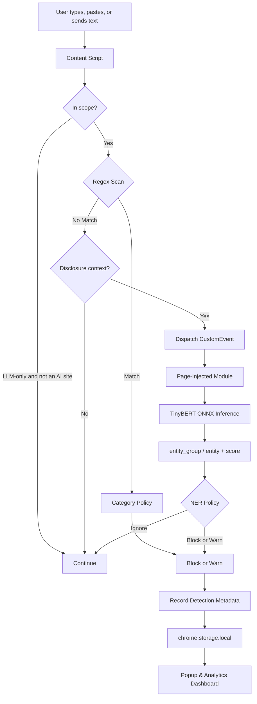

<h1 align="center">🛡️ LLM Data Leakage Monitor</h1>

<p align="center">
  <strong>Privacy-First. AI-Powered. Entirely Local.</strong><br/>
  A Chrome extension that detects and prevents accidental exposure of sensitive information before it reaches AI chat interfaces.
</p>

<p align="center">
  
  
  
  
  
  
</p>

<p align="center">
  
</p>

---

## 📌 Overview

**LLM Data Leakage Monitor (LDLM)** is a privacy-focused Chrome extension designed to detect sensitive information before it is submitted to AI assistants such as ChatGPT, Claude, and Gemini.

It combines deterministic pattern matching with lightweight, locally executed NLP inference to identify potential data leaks directly in the browser.

Instead of sending user input to an external security service, LDLM processes detection requests locally and applies configurable protection policies.

### Why LDLM?

As AI assistants become part of everyday development and productivity workflows, users may unintentionally paste API keys, passwords, personal information, database credentials, or confidential text into AI prompts.

Traditional pattern matching catches recognizable secrets but can miss contextual information. ML-based detection can identify certain named entities that do not match predefined patterns.

LDLM combines both approaches in a single browser-based protection layer.

**Core principle:** Detect locally. Protect before submission. Keep sensitive content on the user's device.

## ✨ Key Features

| Feature | Description |
|---|---|
| 🔍 Hybrid Detection | Regex scanning followed by local TinyBERT NER inference |
| ⌨️ Send Intercept | Capture-phase Enter / Send / submit guards on ChatGPT and Claude |
| 🌐 LLM-sites Scope | By default monitors AI chat sites only; optional all-sites mode |
| 🎯 Category Policies | Secrets and identity block; email, names, and hashes warn |
| ⚡ Real-Time Monitoring | Monitors supported text inputs and content-editable fields |
| 🔐 Privacy-First Architecture | No external inference API or telemetry server |
| 🚫 Block Mode | Clears detected input and prevents submission |
| ⚠️ Warn Mode | Highlights suspicious input and displays a warning |
| 📊 Analytics Dashboard | Visualizes detection activity, categories, and target domains |
| 🧾 Event History | Stores up to 200 detection events locally |
| ⚙️ Configurable Protection | Modes, category actions, coverage, and trusted domains |
| 📤 CSV Export | Export recorded detection metadata |
| 🧪 Automated Tests | Shared detection helpers plus a 200-case labeled dataset |
| 🌐 Offline Inference | Runs the local ONNX model using WebAssembly |

## 🧠 Project Type: Applied Machine Learning

LDLM is an **applied ML and browser-security project**, not a generative AI application.

It integrates a pretrained, fine-tuned TinyBERT model for Named Entity Recognition (NER) into a client-side security workflow. The model is used as-is; custom model training is not part of the current implementation.

The detection system has two layers:

**Layer 1 — Regex Engine**

Scans text against predefined patterns for structured secrets and personal information. This provides fast, deterministic detection for supported formats.

**Layer 2 — TinyBERT NER**

Processes text using a local ONNX model to identify named entities that may be missed by regex, such as people, organizations, and locations, depending on the model's learned labels and the extension's post-processing logic.

The extension combines these signals with global mode, category policy, and (for NER) disclosure context before it blocks, warns, or ignores the text.

> **Important distinction:** The pretrained model is a general NER model, not a dedicated classifier trained specifically on API keys, passwords, or every category of PII. Regex handles the explicitly defined secret patterns, while NER provides complementary entity detection. Detection accuracy depends on the patterns, model labels, and decision logic.

## ⚙️ How It Works



On ChatGPT and Claude, Enter and the Send button are intercepted in the capture phase. Regex hits in Block mode are stopped immediately. NER only holds a send when the text looks like a personal disclosure.

### Detection Pipeline

1. **Scope:** By default, detection runs on LLM chat sites (ChatGPT, Claude, Gemini, Copilot, and similar). All-sites mode is optional.
2. **Monitor:** The content script observes supported text-entry elements and send actions.
3. **Inspect:** Input is checked against 24 regex patterns in `detection-core.js`; category mapping is maintained separately.
4. **Policy:** Each matched category maps to block, warn, or ignore. Secrets and identity default to block; email, names, and generic hashes default to warn.
5. **Escalate:** If regex does not match and the text contains a disclosure cue, it is passed to local NER.
6. **Evaluate:** NER uses `entity_group` or `entity`, ignores `LABEL_0` / `O`, requires score `> 0.75`, and still requires disclosure context.
7. **Protect:** Block clears the field and prevents send. Warn highlights the field and still allows send.
8. **Record:** Detection metadata is stored in `chrome.storage.local`.
9. **Visualize:** The popup and dashboard display detection statistics and event history.

**Why run inference in the page context?**

The project uses a page-injected ES module to execute local ONNX inference. This avoids loading the model into the Chrome Manifest V3 background service worker, where service-worker lifecycle and worker restrictions complicate the inference setup. The background script instead handles extension lifecycle events and model-status communication.

The inference module uses locally bundled JavaScript and WebAssembly assets.

## 🔬 Model Details

| Property | Details |
|---|---|
| Hugging Face repository | [`onnx-community/TinyBERT-finetuned-NER-ONNX`](https://huggingface.co/onnx-community/TinyBERT-finetuned-NER-ONNX) |
| Original base checkpoint | [`adel-cybral/TinyBERT-finetuned-NER`](https://huggingface.co/adel-cybral/TinyBERT-finetuned-NER) |
| Architecture | Four-layer TinyBERT |
| Model task | Named Entity Recognition / token classification |
| Output labels | `LABEL_0`–`LABEL_8` (CoNLL-style O / MISC / PER / ORG / LOC) |
| Decision threshold | Score `> 0.75` after aggregation |
| Model format | Quantized ONNX |
| Runtime | ONNX Runtime WebAssembly |
| Approximate model size | 14.5 MB (checked-in `model_quantized.onnx` file) |
| Fine-tuning in this project | None |
| Inference location | Browser, using local model assets |
| External inference APIs | None |

### Why TinyBERT?

TinyBERT provides a compact transformer architecture suitable for resource-constrained inference compared with larger transformer models.

In LDLM, it complements regex-based detection by identifying certain contextual entities, while ONNX Runtime enables model execution in a browser environment.

### Future Model Improvements

Potential improvements include:

- Fine-tuning a token-classification model on a properly labeled, PII-focused dataset.
- Adding dedicated detection for API secrets, credentials, and organization-specific identifiers.
- Evaluating precision, recall, F1-score, and false-positive rates by category.
- Benchmarking inference latency, memory usage, and model size.
- Calibrating confidence thresholds and entity-label mappings.

## 🔍 Detection Capabilities

### Layer 1 — Regex Detection

The extension implements **24 regex scan patterns** in `detection-core.js`. A separate category map associates matches with policy labels; some patterns overlap, and the exact categories depend on the matched content.

| Category | Examples |
|---|---|
| Personal Information | Email addresses, phone numbers, SSNs |
| Payment Information | Visa, Mastercard, American Express, Discover card formats |
| Cloud Credentials | AWS access-key patterns and supported Google API-key patterns |
| Authentication Secrets | JWTs, bearer tokens, OAuth tokens, secret keys |
| Cryptographic Material | PEM-formatted private keys |
| Database Credentials | MongoDB, PostgreSQL, MySQL, Redis connection strings |
| Identity Information | Medical record numbers, employee IDs, driver's licenses, passports |
| Sensitive Phrases | Patterns such as `My password is ...` and `My name is ...` |

Regex rules are deterministic for their supported formats. A matching pattern does not necessarily establish that a value is valid, active, or genuinely confidential.

### Layer 2 — TinyBERT NER

When regex does not match **and** the text looks like a disclosure (for example `my name is` or `I live at`), the extension can pass the text to the locally hosted NER model.

The page module returns raw entities. Shared logic in `detection-core.js` then:

- Reads `entity_group` (aggregated) or `entity` (token-level).
- Maps `LABEL_0`–`LABEL_8` to O / MISC / PER / ORG / LOC.
- Ignores outside tags and scores at or below `0.75`.
- Ignores ordinary mentions such as “I work at Google in London”.

NER is not a universal secret detector. Its output depends on the model's training data, label mapping, and this post-processing.

### Protection Modes

| Mode | Behavior |
|---|---|
| **Block** | Applies category policy: secrets/identity clear the field and prevent send; warn-level categories only highlight |
| **Warn** | Caps every category at warn: highlight and allow send |
| **Off** | Disables detection |

### Category Policy Defaults

| Group | Examples | Default action |
|---|---|---|
| Secrets | API keys, JWTs, PEM, passwords, DB URLs | Block |
| Identity | SSN, cards, passport, medical IDs | Block |
| Tokens | Generic 32/40/64-character strings | Warn |
| Contact | Email, phone | Warn |
| Personal | “My name is …”, address phrases | Warn |
| NER | Person / org / location with disclosure | Warn |

Policies are configurable in the dashboard. Global Warn mode never blocks.

### Coverage

| Scope | Behavior |
|---|---|
| **LLM sites only** (default) | Monitors ChatGPT, Claude, Gemini, Copilot, and similar hosts. The ONNX model is injected only on in-scope pages. |
| **All sites** | Monitors supported inputs on every page. |

ChatGPT (`chatgpt.com`, `chat.openai.com`) and Claude (`claude.ai`) have dedicated composer/send adapters. Other listed LLM hosts still get regex coverage under the default scope.

Regex matches are handled synchronously on paste, drop, Enter, Send, and form submit. BERT-only results still need inference time and only delay send when disclosure context is present.

## 📊 Interactive Analytics Dashboard

The full-page dashboard provides visibility into detection activity without requiring users to inspect the browser console.

### Dashboard Overview

- Animated header with gradient typography and a protection-status indicator.
- Six statistic cards covering blocked events, warnings, recent activity, protected sites, BERT detections, and top categories.
- Seven-day sparkline trends for supported statistics.
- A 24-hour activity timeline using hourly buckets.
- Category distribution bar chart.
- Regex-versus-BERT detection-method donut chart.
- Top-targeted-domains chart.
- Last-updated timestamp refreshed every 30 seconds.

### Event Log

- Detection history with a limit of 200 stored events.
- Color-coded blocked and warned records.
- Expandable event details.
- Filters for action, method, category, and domain.
- CSV export with export-status feedback.
- Clear-all control.

### Settings

- Block, Warn, and Off mode selection.
- Coverage: LLM sites only or all sites.
- Category policy (block / warn / ignore per group).
- Domain allowlist management.
- Extension status information.
- Quick enable/disable control.

### Popup

The compact extension popup provides:

- Model status: Loaded, Loading, or Failed.
- Blocked, warned, and recent-activity counters.
- One-click Block, Warn, and Off controls.
- An LLM-sites-only checkbox.
- A list of the five most recent detections.
- An Open Full Dashboard action.

## 🏗️ Project Structure

```text
llm-data-leakage-monitor/
│
├── manifest.json
├── background.js
├── detection-core.js
├── site-adapters.js
├── content.js
│
├── popup.html
├── popup.js
│
├── dashboard.html
├── dashboard.js
├── dashboard_preview.html
│
├── test_page.html
├── test_detection_core.js
├── test_regex_detection.js
├── test_questions.json
│
├── download_model.py
│
├── web_model/
│   └── bert-tiny-ner/
│       └── onnx/
│           └── model_quantized.onnx
│
├── wasm/
│   └── ONNX Runtime WebAssembly assets
│
└── libs/
    ├── transformers.min.js
    └── page-injected-module.js
```

| File / Directory | Responsibility |
|---|---|
| `manifest.json` | Chrome Manifest V3 configuration and permissions (v1.8) |
| `background.js` | Extension lifecycle, default settings merge, and model-status relay |
| `detection-core.js` | Shared regex, category policy, and NER decision logic |
| `site-adapters.js` | ChatGPT / Claude composers, send buttons, and LLM host list |
| `content.js` | Input monitoring, send intercept, protection, and event logging |
| `page-injected-module.js` | Local transformer initialization and ONNX inference |
| `popup.js` | Popup controls, coverage toggle, and recent-event summaries |
| `dashboard.js` | Analytics, charts, filters, settings, and event history |
| `dashboard_preview.html` | Standalone dashboard preview with mock data |
| `test_page.html` | Manual detection testing, including a ChatGPT send-intercept mock |
| `test_detection_core.js` | Unit checks for policy, NER helpers, and adapters |
| `test_regex_detection.js` | Combined regex + NER dataset runner |
| `test_questions.json` | 200 labeled test cases |
| `download_model.py` | Downloads and prepares the ONNX model |
| `web_model/` | Local model assets |
| `wasm/` | WebAssembly runtime assets |
| `libs/transformers.min.js` | Bundled transformer library |

## 🚀 Installation & Setup

### Prerequisites

- Google Chrome or another compatible Chromium-based browser.
- Node.js and npm only if you want to run the automated tests.
- Python 3, `pip`, and internet access only if you need to download or refresh the model assets.

### 1. Clone the repository

```bash
git clone <YOUR_REPOSITORY_URL>
cd llm-data-leakage-monitor
```

Replace `<YOUR_REPOSITORY_URL>` with your repository URL.

Alternatively, download the repository and extract it locally.

### 2. Install JavaScript dependencies (for tests)

```bash
npm install
```

The extension itself does not need `npm install`; its browser runtime assets are bundled in the repository. The npm dependencies support the Node-based test scripts.

### 3. Install the model downloader dependency (only if needed)

```bash
python -m pip install huggingface_hub
```

### 4. Download the ONNX model (only if missing or refreshing)

```bash
python download_model.py
```

The checked-in repository already includes the model and tokenizer assets. Run this only if the model file is missing or you want to refresh the assets. The script downloads the quantized model from Hugging Face and places it under:

```text
web_model/bert-tiny-ner/onnx/model_quantized.onnx
```

It also handles the documented legacy model-filename variation.

### 5. Load the extension into Chrome

1. Open `chrome://extensions/`.
2. Enable **Developer mode**.
3. Select **Load unpacked**.
4. Choose the project directory containing `manifest.json`.
5. Confirm that the extension appears in the toolbar.

### 6. Verify the installation

Click the extension icon. Confirm that **LLM sites only** is enabled if you want the default scope.

Open ChatGPT or Claude (or `test_page.html` with the extension allowed on file URLs) and check that the model status becomes Loaded. The ONNX model is not injected on unrelated sites under the default scope.

Open the full dashboard to review mode, coverage, category policy, and detection history.

**Note:** The browser extension requires its referenced local model and runtime files to be present. The dashboard preview can be opened separately without installing the extension.

## 🧪 Testing

### Manual Testing

Open `test_page.html` in Chrome with the unpacked extension loaded (enable **Allow access to file URLs** if you open it from disk) and try the following sample inputs.

| Test Input | Default expected action |
|---|---|
| `test@example.com` | Warn (contact) |
| `AKIA1234567890ABCDEF` | Block (AWS key) |
| `My SSN is 123-45-6789` | Block (SSN) |
| `My password is example123` | Block (password phrase) |
| `Explain Kubernetes at Google` | Allow |
| ChatGPT mock composer + Send | Regex block on secrets before send |

Use synthetic test data only. The examples are intended to exercise pattern matching and do not represent real credentials.

### Automated Testing

```bash
npm test              # policy, NER helpers, and adapters
npm run test:dataset  # 200-case regex + NER pipeline (needs the ONNX model)
```

The dataset runner uses the same `evaluateRegex` / `evaluateNer` helpers as the extension. Review the output for its accuracy report and individual failures.

**Evaluation note:** The reported results depend on the test dataset, expected labels, and implementation of the runner. They should not be interpreted as independent evidence of production accuracy without additional evaluation.

### Suggested Evaluation Metrics

For a stronger ML evaluation, measure:

- Precision and recall by sensitive-data category.
- F1-score for the overall detection pipeline.
- False-positive and false-negative rates.
- Regex-only versus combined-pipeline performance.
- Median and 95th-percentile inference latency.
- Browser memory consumption and model initialization time.

### Troubleshooting

**Model not found**

```bash
python download_model.py
```

**Model fails to load**

- Verify that the ONNX file exists at the expected path.
- Check the browser console for model-loading or WebAssembly errors.
- Confirm that the referenced JavaScript and runtime files are present.
- Reload the extension after correcting the issue.

**Extension fails to load**

- Inspect `manifest.json` for missing paths or invalid permissions.
- Open the extension's error details in `chrome://extensions/`.
- Check the console for JavaScript errors.

## 🔐 Privacy & Security

Privacy is a core design requirement of LDLM.

- **Local inference:** The ONNX model runs inside the browser.
- **No inference API:** User text is not sent to a remote AI or classification service by the detection pipeline.
- **Local event storage:** Detection history is stored in `chrome.storage.local`.
- **Bundled runtime:** Transformer and WebAssembly assets are loaded locally.
- **Initial setup download:** The model is downloaded from Hugging Face during setup.
- **Configurable protection:** Users can choose detection mode, LLM-only vs all-sites coverage, category policy, and trusted domains.

### Important Limitations

LDLM is a defense-in-depth tool, not a guarantee against every form of data leakage.

- Regex rules only detect supported formats and may produce false positives or miss unfamiliar formats.
- General-purpose NER models may miss sensitive information. LDLM therefore requires disclosure context and a 0.75 score, which reduces false positives and can also miss unlabeled PII.
- ChatGPT and Claude adapters depend on composer/send selectors that can change with those UIs.
- Under **LLM sites only**, non-listed sites are unprotected unless the user switches to all-sites mode.
- Page-specific JavaScript, shadow DOM, custom editors, and unsupported input paths can affect coverage.
- Asynchronous NER can still delay a disclosure-shaped send by up to a few seconds.
- A domain allowlist intentionally bypasses protection on configured trusted domains.
- Local event history can contain sensitive metadata, depending on the fields recorded by the implementation.
- Disabling the extension or using an unsupported browser context removes or limits its protection.

The local-first design reduces unnecessary external data exposure, but its effectiveness still depends on the implementation, browser permissions, and detection coverage.

## 🛠️ Technology Stack

| Area | Technologies |
|---|---|
| Browser Extension | JavaScript, Chrome Extensions API, Manifest V3 |
| Pattern Detection | Regular expressions |
| Natural Language Processing | TinyBERT, Named Entity Recognition |
| Model Format | ONNX, quantized model |
| Inference Runtime | ONNX Runtime WebAssembly |
| Transformer Runtime | `@xenova/transformers` v2 |
| Browser Communication | CustomEvent, `dispatchEvent` |
| Send Intercept | Capture-phase `keydown`, `pointerdown`, `click`, and `submit` |
| Site Adapters | ChatGPT and Claude composer/send selectors |
| Dynamic DOM Monitoring | MutationObserver |
| Local Persistence | `chrome.storage.local` |
| Dashboard | HTML, CSS, JavaScript, Canvas API |
| Automated Testing | Node.js |
| Model Setup | Python, `huggingface_hub` |

## 🧩 Engineering Challenges & Fixes

| Challenge | Resolution |
|---|---|
| Remote library imports incompatible with Manifest V3 restrictions | Bundled the transformer library locally |
| Background service worker crashes during model initialization | Moved inference out of the service worker |
| Incorrect entity-label assumptions | Shared helper reads `entity_group` or `entity` and maps `LABEL_0`–`LABEL_8` |
| NER/test logic drifted apart | Regex and NER decisions live in `detection-core.js` for extension and tests |
| Overly broad identity-document patterns | Tightened supported label-prefix requirements |
| Secret patterns failed on common assignment phrases | Added support for `:`, `=`, and `is` |
| Chat UIs send on Enter before debounce | Capture-phase send intercept plus ChatGPT/Claude adapters |
| Form `preventDefault` after `await` was too late | Synchronous regex check on submit |
| Ordinary names and cities triggered NER | Disclosure filter, 0.75 threshold, and category policy |
| TinyBERT loaded on every website | Default LLM-sites-only scope |
| Browser caching configuration was ineffective | Replaced the ineffective setting with the supported configuration |
| Inline popup scripts conflicted with extension CSP | Moved popup logic into `popup.js` |
| Model filename inconsistencies | Added filename handling to the download script |

## 🔮 Future Scope

- Develop a dedicated PII and secret-detection model.
- Add Gemini / Copilot composer adapters (hosts are already in the LLM allowlist).
- Add a false-positive “this was wrong” control on the toast.
- Store redacted snippets in the event log.
- Benchmark inference latency across devices and browsers.
- Expand the test dataset with representative, synthetic edge cases.
- Add browser-level regression tests for send interception.
- Explore privacy-preserving, local policy updates without uploading user text.

## 🎯 Project Impact

LDLM demonstrates how lightweight NLP, deterministic pattern matching, and browser-extension engineering can be combined to address a practical AI security problem.

The project brings together:

- Applied machine learning and transformer inference.
- ONNX model deployment in a browser environment.
- Client-side security and privacy engineering.
- Real-time input monitoring and event handling.
- Analytics dashboards and local event storage.
- Automated testing and model evaluation.

It illustrates an important principle for AI-assisted workflows: **sensitive-data protection can be implemented at the point of input without requiring a remote inference service.**

## 👨‍💻 Author

**Vedant Atri**

B.Tech | Machine Learning | NLP | AI Security

Interested in applied machine learning, intelligent systems, privacy engineering, and practical AI applications.

---

<p align="center">
  <strong>Built to make AI-assisted workflows safer, one prompt at a time. 🔒</strong>
</p>
