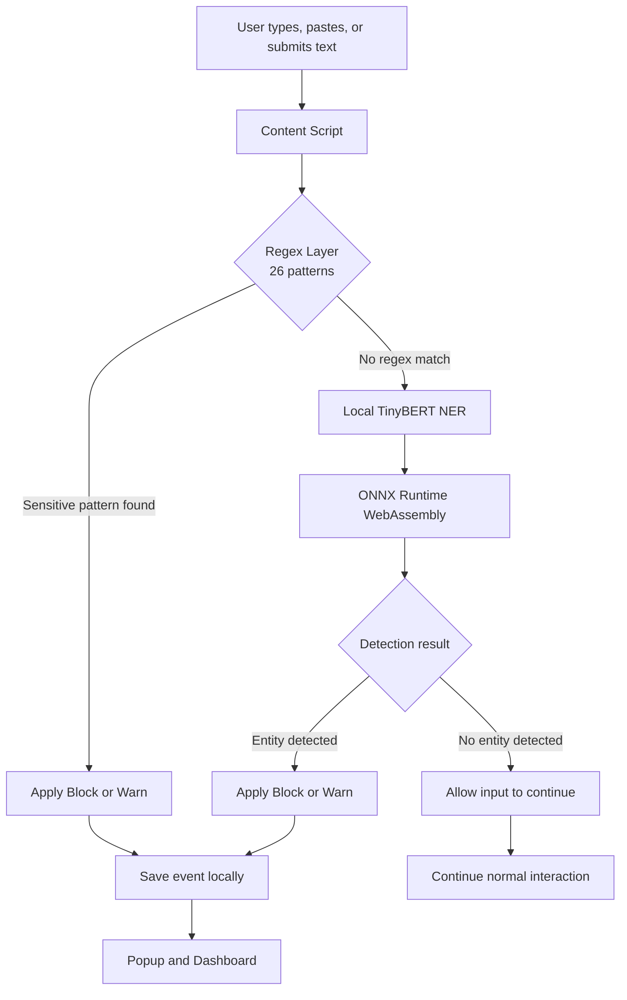

<div align="center">


<br/>

### Your data. Your browser. Your control.

**A privacy-focused Chrome extension that detects potentially sensitive information before it reaches AI chat interfaces.**

Regex precision at the first layer. Local TinyBERT inference at the second. No external API calls during normal operation.

<br/>


<br/><br/>

[Features](#-features) · [Architecture](#-how-it-works) · [Model](#-the-ml-model) · [Installation](#-installation) · [Testing](#-testing) · [Privacy](#-privacy-by-design)

</div>

---

## The Problem

AI assistants are useful, but prompts can accidentally contain information that should never leave your device.

An email address, access token, database connection string, private key, or personal identifier can end up in a prompt before you realize it.

**LLM Data Leakage Monitor adds a detection layer between your input and the AI interface.**

It examines text in supported input fields, detects potentially sensitive content, and applies your selected protection mode before the content is submitted.

<div align="center">


<sub>Privacy-first detection with an interactive dashboard and local event history.</sub>

</div>

## ⚡ At a Glance

<table>
<tr>
<td width="50%" valign="top">

### 🛡️ Two-Layer Detection

- 26 regex patterns
- 15+ sensitive-data categories
- Local TinyBERT NER inference
- Configurable Block, Warn, and Off modes

</td>
<td width="50%" valign="top">

### 🔒 Local-First Processing

- No external API calls during normal operation
- ONNX Runtime WebAssembly inference
- Local browser storage
- One-time model download during setup

</td>
</tr>
<tr>
<td width="50%" valign="top">

### 📊 Security Dashboard

- Detection statistics and trends
- Activity timeline and category charts
- Detection method breakdown
- Filterable event history and CSV export

</td>
<td width="50%" valign="top">

### ⚙️ Browser Integration

- Chrome Manifest V3
- Popup with model status and recent events
- Domain allowlist
- Settings and quick protection controls

</td>
</tr>
</table>

---

## 🧠 How It Works

The extension uses a layered pipeline designed to check common patterns quickly before invoking the local ML model.



### Layer 1 — Regex Detection

Fast, deterministic pattern matching identifies common sensitive values without needing ML inference.

The current implementation contains 26 patterns spanning 15+ categories, including:

| Category | Examples |
|---|---|
| Personal information | Email addresses, phone numbers, SSNs |
| Financial data | Credit card number patterns |
| Credentials | API keys, access tokens, bearer tokens, JWTs |
| Infrastructure secrets | Database connection strings, PEM private keys |
| Identity records | Medical record numbers, employee IDs, passport and driver's license patterns |
| Sensitive phrases | Patterns such as `"My password is..."` |

Regex detection is the first line of defense. Matching a pattern does not prove that a value is genuine or active, and some legitimate text may trigger a warning.

### Layer 2 — Local TinyBERT Inference

When the regex layer does not find a match, the extension can pass the input through a locally executed TinyBERT-based Named Entity Recognition model.

- Detects named entities such as persons, locations, and organizations.
- Runs through ONNX Runtime WebAssembly.
- Does not require a remote inference API.
- Can identify some entities that pattern matching alone may miss.

**Important:** The current model is a general NER model, not a custom-trained PII classifier. It is not guaranteed to recognize passwords, API keys, or every type of sensitive information. Regex and NER complement each other; neither guarantees complete protection.

### Protection Modes

| Mode | Behavior |
|---|---|
| 🔴 **Block** | Clears the affected field and displays a red notification. |
| 🟠 **Warn** | Highlights the field in amber and displays a warning. |
| ⚪ **Off** | Disables detection. |

Regex matches can be blocked synchronously in supported input events. BERT-only findings are processed asynchronously, so the implementation clears the field after inference rather than guaranteeing that every sensitive value is prevented from momentarily entering the page.

---

## 🧪 The ML Model

This is an **applied machine learning project**, not a generative AI application.

The model performs token classification for Named Entity Recognition (NER). It does not generate responses or understand every kind of secret.

| Property | Details |
|---|---|
| Model repository | [`onnx-community/TinyBERT-finetuned-NER-ONNX`](https://huggingface.co/onnx-community/TinyBERT-finetuned-NER-ONNX) |
| Original base | `adel-cybral/TinyBERT-finetuned-NER` |
| Architecture | Four-layer TinyBERT, `BertForTokenClassification` |
| Task | Named Entity Recognition |
| Output labels | `LABEL_0` through `LABEL_8` |
| Runtime | ONNX Runtime WebAssembly |
| Model size | Approximately 36 MB, quantized |
| Fine-tuning | No custom fine-tuning in this project |
| Inference location | Browser, locally |

### Why ONNX?

ONNX provides a portable model representation that can run through a browser-compatible inference runtime.

In this project, it enables local inference without sending text to a hosted model API.

The model is downloaded during setup and stored in the project. The extension also bundles its JavaScript and WebAssembly runtime dependencies locally.

---

## 📊 Dashboard & Monitoring

The full-page dashboard turns detection events into a reviewable activity history.

| Component | What it shows |
|---|---|
| **Live statistic cards** | Total blocked, total warned, recent activity, protected sites, BERT detections, and top category |
| **Activity timeline** | Hourly event activity over the last 24 hours |
| **Category chart** | Distribution of detected sensitive-data categories |
| **Detection method chart** | Regex versus BERT detection breakdown |
| **Targeted domains** | Domains associated with recorded events |
| **Event log** | Up to 200 events with filters and expandable details |
| **CSV export** | Export recorded event history |
| **Settings** | Protection mode, domain allowlist, and extension status |

The popup provides quick access to model status, protection controls, counters, recent events, and the full dashboard.

---

## 🏗️ Project Architecture

```text
Chrome Browser
│
├── manifest.json
│
├── background.js
│   └── Extension lifecycle and model-status relay
│
├── content.js
│   ├── Input monitoring and event handling
│   ├── Regex detection
│   ├── Block / Warn behavior
│   └── Local event logging
│
├── page-injected-module.js
│   └── TinyBERT ONNX inference in page context
│
├── popup.html / popup.js
│   └── Quick controls and recent events
│
├── dashboard.html / dashboard.js
│   └── Analytics, event history, settings, and charts
│
├── web_model/bert-tiny-ner/
│   └── Local ONNX model
│
├── wasm/
│   └── ONNX Runtime WebAssembly binaries
│
├── libs/
│   ├── transformers.min.js
│   └── page-injected-module.js
│
└── Testing
    ├── test_page.html
    ├── test_regex_detection.js
    └── test_questions.json
```

### Why does inference run in the page context?

The project uses a separate page-injected module for inference instead of loading the model inside the Manifest V3 background service worker.

The implementation uses this arrangement because the ONNX runtime's worker requirements are incompatible with the extension service-worker execution context used by this project.

The background service worker remains responsible for lifecycle and model-status handling.

---

## 🚀 Installation

### Prerequisites

- Google Chrome or another compatible Chromium-based browser
- Node.js and npm for the test runner and JavaScript dependencies
- Python 3 and pip for the model download script

### 1. Clone the repository

```bash
git clone https://github.com/RevHeadGuy/LLM_DATA_LEAKAGE_MONITOR.git
cd LLM_DATA_LEAKAGE_MONITOR
```

### 2. Install dependencies

```bash
npm install
python -m pip install huggingface_hub
```

### 3. Download the model

```bash
python download_model.py
```

This downloads the quantized ONNX model from Hugging Face into the local model directory.

### 4. Load the extension

1. Open `chrome://extensions/`.
2. Enable **Developer mode**.
3. Select **Load unpacked**.
4. Choose the repository directory.
5. Pin the extension to your toolbar if desired.

### 5. Verify the installation

Open the extension popup and check the model status. Once the model has loaded, open the dashboard to inspect activity and settings.

---

## 🧭 Usage

### Try a detection

1. Open a supported web page with an input field.
2. Type or paste a test value.
3. Observe the configured Block or Warn behavior.
4. Open the extension popup to inspect recent events.
5. Open the full dashboard to view event details and analytics.

### Manual test examples

Use synthetic values only.

| Test input | Expected detector |
|---|---|
| `test@example.com` | Email regex |
| `AKIA1234567890ABCDEF` | AWS-style key regex |
| `My SSN is 123-45-6789` | SSN / phrase patterns |
| `sk-abcdefghijklmnopqrstuvwxyz123456` | Secret-key pattern |

These are test examples, not proof that every format or credential type will be detected.

### Domain allowlist

Add trusted domains in **Settings → Domain Allowlist**. The extension is configured to stay silent on those domains.

Only allowlist domains you trust, since doing so intentionally reduces protection there.

---

## 🧪 Testing & Evaluation

The repository includes a manual test page and an automated test runner.

### Manual testing

Open `test_page.html` in Chrome and exercise typing, paste, drag-and-drop, and form submission.

### Automated tests

Run from the project directory:

```bash
node test_regex_detection.js
```

The test runner evaluates the regex and BERT detection logic against the 200 labelled cases in `test_questions.json`.

If the local model cannot be found, run:

```bash
python download_model.py
```

### What should be evaluated next?

For a security-focused ML project, useful evaluation measures include:

- Precision and recall by sensitive-data category
- False-positive and false-negative rates
- Regex-only versus combined-pipeline performance
- BERT inference latency and model initialization time
- Behavior across different input types and supported websites

The presence of a test dataset does not itself establish a particular accuracy score. Publish measured results only after running the tests and recording the methodology.

---

## 🔐 Privacy by Design

Privacy is the core design goal of this project.

- **Local inference:** text is processed using the local ONNX model.
- **No hosted inference API:** the extension does not send text to an external inference service during normal operation.
- **Local history:** event records are stored in `chrome.storage.local`.
- **Bundled runtime:** model execution uses local JavaScript and WebAssembly assets.
- **Setup-time download:** Hugging Face is contacted to download the model during setup.

### Important security boundaries

This extension is a defensive prototype, not a guarantee against every form of data leakage.

- Regex patterns can miss unfamiliar formats and may produce false positives.
- General NER models do not reliably recognize all secrets or credentials.
- Asynchronous model inference creates timing limitations for BERT-only detections.
- Domain allowlisting disables protection on the allowed domains.
- Browser extension behavior can vary by website and input mechanism.

Avoid entering real credentials or personal information into test pages. Validate the extension on the specific websites and input flows you intend to protect.

---

## 🛠️ Engineering Lessons

This project explores several practical engineering challenges:

- Combining deterministic rules with local machine learning
- Running ONNX inference inside a browser extension
- Working within Chrome Manifest V3 execution constraints
- Coordinating content scripts and page-context inference
- Building a usable event history and analytics dashboard
- Testing detection behavior against labelled examples
- Balancing security, latency, and usability

The goal is not simply to detect sensitive strings. It is to integrate detection into a browser workflow while keeping data local and behavior reviewable.

---

## 🗺️ Roadmap

Potential next steps:

- [ ] Measure precision, recall, and false-positive rates on labelled test data
- [ ] Add category-specific evaluation reports
- [ ] Investigate PII-specific fine-tuning of the NER model
- [ ] Expand test coverage across websites and input mechanisms
- [ ] Improve inference feedback and timing behavior
- [ ] Add reproducible performance benchmarks
- [ ] Document supported browser permissions and security boundaries

These are future improvements, not claims about the current implementation.

---

## 🤝 Contributing

Contributions and issue reports are welcome.

Useful contributions include new synthetic detection test cases, reproducible bug reports, evaluation improvements, and browser compatibility fixes.

When proposing detection changes, include the test inputs and expected outcomes. Never include real passwords, API keys, tokens, or personal information in issues or pull requests.

---

<div align="center">


### Protect the prompt. Keep the data local.

*LLM Data Leakage Monitor — Applied ML for privacy-conscious AI usage.*

<a href="https://github.com/RevHeadGuy">

</a>

</div>
